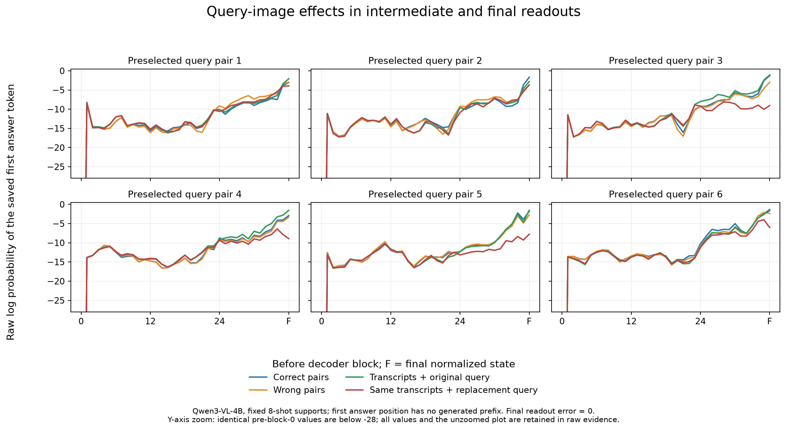

# Historical OCR: contrastive ICL and visual versus linguistic evidence

> Historical EXP-018 analysis/proposal; its dated evidence is preserved below. For the current
> direction and approval state after EXP-021, use [research index](README.md) and
> [current synthesis](exp-018-contrastive-icl-analysis.md). Older proposed work is not a release.

Owner: Manager with the existing Research agent. Updated: **17 October 2026**. Status: **development and full EXP-018 validation completed and audited**. This note preserves the method and 12 October development record; the latest full results are in [EXP-018](../results/EXP-018.md), with [Research interpretation and next plan](exp-018-contrastive-icl-analysis.md).

This revision narrows the earlier proposal to one step: **eight-shot association-contrastive decoding**, with a small query-image and logit-lens diagnostic. The earlier fine-tuning ablations, Base/chat comparison and larger execution matrix are deferred. The complete 11 October proposal is preserved privately at `.local/research-review-archive/2026-10-11-icl-decoding-and-adaptation-scope.md.gz`; previous experiment and research records remain intact.

## 1. What EXP-016 establishes

The important distinction is **support images versus the query image**. Our “transcripts-only” condition removes the eight or 24 demonstration images. It retains the real validation crop. The vision encoder and multimodal decoder still participate.

Verified implementation: [`region_pipeline.py`](../src/active_ocr/region_pipeline.py), `_inputs`: lines 87–89 remove images only from support messages; lines 94–95 construct and append the real query. The query reference is absent from generation inputs. In all three conditions, a fresh chat contains TRAIN supports followed by the query.

| Condition | Demonstrations | Query | What its comparison tests |
|---|---|---|---|
| Correct pairs | TRAIN crop + its transcript | Real VAL crop | Ordinary multimodal ICL |
| Transcripts only | Same TRAIN transcripts, no support crops | Same real VAL crop | Added value of support images under this recipe |
| Mismatched pairs | Same crop/transcript multisets, crops rotated by one position | Same real VAL crop | Sensitivity to incorrect support associations |

The pinned Qwen3-VL-4B-Instruct revision is `ebb281ec70b05090aa6165b016eac8ec08e71b17`. The bank is the EXP-013 seed-824 selection: **24 TRAIN pages / 589 lines**. Eight or 24 distinct support lines are chosen deterministically per query; the bank is not inserted wholesale into each prompt. Inputs are supplied through the native Hugging Face chat template. Eight-shot paired inference has nine images: eight supports and one query; transcripts-only has one.

Raw corpus line CER, recomputed and recorded in [EXP-016](../results/EXP-016.md), on **VAL42 / 861 lines**:

| Condition | 8-shot CER (%) | 24-shot CER (%) |
|---|---:|---:|
| Correct pairs | 79.8331 | 80.8924 |
| Transcripts only | 80.5965 | 79.8095 |
| Mismatched pairs | 96.8874 | 94.8695 |

The reused original zero-shot CER is **86.3601%**; the reused EXP-013 24-page LoRA CER is **43.0499%**. These are the raw line metrics, not the older page-joined/cap-as-empty scores. Fine-tuning uses all 589 training lines; each ICL query sees eight or 24. The sizeable gap remains a measured research motivation, not something contrastive decoding is already known to close.

At equal shot counts, removing support images changes CER by **+0.7634** points at eight shots and **−1.0829** at 24. Mismatching increases it by **17.0543** and **13.9771** points. Small aggregate differences do not establish equivalence; individual errors can differ, and removing images shortens the context.

The asymmetry is not contradictory. Correct support images could provide little additional useful information, while conflicting ones disrupt processing. This does not prove that the model learned the handwriting from correct demonstrations. Nor does it show that a decoder operating without the query image could achieve the same performance.

A further warning comes from our outputs: paired-eight reduced Cyrillic-containing predictions from 164 to two, while mismatched-eight reduced them to one despite substantially worse CER. Conditioning the output script and accurately recognizing characters are different outcomes. Our saved subgroup analysis also shows transcripts-only gains outside those initial wrong-script lines; script correction is not the whole explanation.

## 2. Research question and competing explanations

The immediate question is:

> **Can the difference between correct and mismatched ICL contexts improve transcription, and what evidence shows that the resulting predictions remain responsive to the actual query?**

Three explanations remain plausible:

1. **Text conditions the task.** Demonstration transcripts help with script, domain vocabulary, output style or other expectations; the pretrained query-image pathway supplies the visual evidence. Useful support-image adaptation may be small.
2. **Useful association information exists but is weak at decoding.** Correct-versus-corrupted contexts may expose a signal that ordinary greedy generation underuses. Contrastive decoding could amplify it.
3. **Mismatch mainly creates interference.** The difference may reflect disrupted attention, conflicting context or positional effects rather than useful glyph–transcript correspondence. Subtracting it could be ineffective or damaging.

These are hypotheses. Current CER cannot select an internal mechanism among them. “Reading” and language-assisted completion also coexist: a predictable word may require little extra image evidence, whereas an incorrect word can arise from image-conditioned misrecognition.

## 3. Primary literature and its limits

This is a focused primary-source review, not an exhaustive systematic review. Manager and Research used the installed scientific-brainstorming and systematic-literature-review skills. Searches targeted multimodal ICL controls, contrastive decoding, historical-OCR grounding, and lens validity. Methods, comparison conditions and newer versions were checked; publication status is stated conservatively.

| Primary source; inspected evidence | Relevant finding | Boundary for our project |
|---|---|---|
| [Chen et al., *Can Multimodal Large Language Models Truly Perform Multimodal In-Context Learning?*, WACV 2025](https://arxiv.org/html/2311.18021v2), §§3.1–3.3 | In Flamingo/IDEFICS visual tasks, demonstration images often add little, while removing the query image substantially degrades performance. Text supplies important task information. | Closely supports distinguishing the two image roles. Its latest-image cross-attention explanation is architecture-specific, not an explanation already established for Qwen3-VL handwriting. |
| [Bertini Baldassini et al., *What Makes Multimodal In-Context Learning Work?*, CVPR Workshops 2024](https://arxiv.org/html/2404.15736v2), §4.1 | Removing images and replacing them with mismatched ones have different effects across captioning, VQA and classification; incorrect associations can favor generic caption words. | Harm from inconsistency does not imply an equally large benefit from correct images. These tasks and models are not a direct OCR replication. |
| [Peng et al., *Enhancing Input-Label Mapping in In-Context Learning with Contrastive Decoding*, 2025 preprint](https://arxiv.org/html/2502.13738v1), §§2.2, 3, 5 | ICCD contrasts correct contexts with altered demonstration inputs while retaining labels; it evaluates seven text classification tasks, typically 16 shots and fixed α=1. Negative construction matters. | Best match to our support-association intervention. Handwriting, multimodal supports and unrestricted transcript generation were not tested. Our crop rotation is an adaptation. |
| [Leng et al., *Mitigating Object Hallucinations in Large Vision-Language Models through Visual Contrastive Decoding*, CVPR 2024](https://arxiv.org/html/2311.16922), method and evaluation | VCD contrasts the real query image with a diffusion-noised version, using a positive-branch plausibility constraint. | Original evidence concerns object hallucination/general vision. It targets query evidence, unlike ICCD. A blank image is neither its original protocol nor a pure language-only branch. |
| [Karamolegkou et al., *Reading or Guessing?*, 2026 preprint, v2](https://arxiv.org/html/2605.27750v2), §3, Appendices C.2/D | Historical printed Greek/Arabic study combines perturbations, image-conditioned versus image-free token probabilities, lenses and decoding interventions. Greek lexical errors are more image-dependent than perceptual errors for Qwen3-VL-8B, but less for olmOCR. Qwen-8B VCD median CER changes are +0.13 points in Greek and −0.50 in Arabic. | Direct prior art for historical OCR and contrastive decoding. Image dependence is not correctness. Different scripts, checkpoints, prompts and median-based evaluation prevent direct numerical comparison with our German-handwriting corpus CER. |
| [Qwen3-VL Technical Report](https://arxiv.org/html/2511.21631), §2 | Visual representations enter the language model through the visual interface and DeepStack intermediate-feature injection. | A decoder state is multimodal. Inspecting or adapting it cannot automatically be labeled a language-only operation. |
| [Neo et al., *Towards Interpreting Visual Information Processing in Vision-Language Models*, ICLR 2025](https://arxiv.org/html/2410.07149v2), representation analysis and interventions | Combines vocabulary projections of LLaVA states with visual-token ablation and attention interventions. | Supports combining a lens with interventions. Object semantics and architecture-specific layer behavior do not establish Qwen character recognition. |
| [Krojer et al., *LatentLens*, 2026 preprint, v5](https://arxiv.org/html/2602.00462v5), especially §5 | Contextualized text representations interpret visual tokens more effectively than a plain vocabulary head. In rendered-text examples, visual-patch logit lens can predict continuations rather than the displayed word. | Poor patch readout need not mean missing visual information; readable representations alone do not establish causal use. Building its corpus/index would exceed this small diagnostic. |
| [Belrose et al., *The Tuned Lens*, 2023 preprint, v6](https://arxiv.org/html/2303.08112v6), method | Intermediate representations can be misaligned with the final vocabulary head; learned translators improve decoding them. | An untouched raw lens needs calibration and restrained interpretation. We are not proposing to train a separate probe now. |
| [Cho and Kim, *Revisit What You See*, ACL 2026](https://aclanthology.org/2026.acl-long.262/), [updated method](https://arxiv.org/html/2506.09522v3) | ReVisiT selects and fuses visual-token vocabulary distributions with final decoding distributions on visual-language tasks. | Shows related layer/token-guided decoding already exists. It is not evidence that our handwriting supports are usefully encoded; do not add another decoding method to this first step. |

The directly relevant new boundary is that contrastive decoding and reading-versus-guessing diagnostics have **already been studied in historical OCR**. Our candidate extension is narrower: controlled support associations in frozen-model ICL for historical handwriting. No priority or universal novelty claim is established by this search.

## 4. One next experiment: eight-shot association-contrastive ICL

**Hypothesis:** next-token differences between correctly paired and mismatched supports contain useful information beyond ordinary paired and transcripts-only ICL. Test the fixed recipe first; do not run a method or hyperparameter grid.

Retain the original frozen Qwen checkpoint, seed-824 bank, per-query eight support IDs/order, native template, real query crop and instruction:

```text
USER: [TRAIN crop 1] Transcribe only the text in this cropped line. Return only the transcription.
ASSISTANT: TRAIN transcript 1
... eight support turns ...
USER: [real VAL query crop] same instruction
ASSISTANT: generate query transcription
```

The positive branch is exactly paired-eight. The negative branch keeps the query and transcript sequence fixed, rotating the same eight support crops as in EXP-016. Recheck that no support retains its correct transcript; preserve identities and record image-token lengths/positions. Rotating differently sized crops is not a pure removal of a mathematical “mapping component.”

At output step t, both branches receive **the same answer prefix** selected by the contrastive decoder, while retaining their own context and separate KV caches. Obtain raw next-token logits zP and zM, then use:

\[
z_C(v)=z_P(v)+\alpha\,[z_P(v)-z_M(v)],\qquad \alpha=1.
\]

For intuition, a token favored in both contexts gets little extra advantage; one favored more by the correct context is promoted. This is a conditional preference contrast, not a proven subtraction of language knowledge from vision. Do not independently generate two transcripts and subtract their strings.

For unrestricted OCR, propose one declared extension: **β=0.1 positive plausibility filtering**, inspired by CD/VCD. Calculate eligibility from the positive branch after its established generation processors, so its ordinary greedy winner remains eligible. Combine raw logits first, apply existing processors once to the combined scores using the native positive-context history, then mask. Preserve repetition penalty 1.1, greedy selection, native EOS and the 64-token limit. This is ICCD-inspired OCR, not exact replication of its classification setup.

The implementation gate must show that **α=0**, and separately identical branches, recover native paired greedy tokens. Check common prefixes, finite logits, template/image-label alignment, context capacity and actual stopping metadata on a handful of existing crops. Numerical/cache discrepancies must be resolved before the pilot. No separate full paid smoke experiment is necessary.

Only after approval and those checks: run **one new condition on VAL8 / 182 lines**, preferably using the existing L4 path. Verified historical controls are:

| VAL8 condition | Raw CER (%) | Raw WER | Length-capped outputs |
|---|---:|---:|---:|
| Zero-shot | 91.0573 | 1.219870 | 1 |
| Paired-eight | 80.3567 | 1.175896 | 0 |
| Transcripts-only-eight | 78.4968 | 1.144951 | 0 |
| Mismatched-eight | 98.0892 | 1.376221 | 2 |
| Proposed contrastive-eight | **Not run** | **Not run** | **Not run** |

Reuse predictions only after exact model/input/decoder/slice/evaluator and receipt checks. Do not compare VAL8 performance against the VAL42 numbers above. This slice has already been inspected and is development evidence, not an independent test.

Report all-output NFC corpus line CER, WER, improved/worsened/tied lines, damage to initially correct lines, output lengths, EOS/caps and actual runtime/token/memory use. Keep generated strings rather than scoring capped outputs as empty. A gain produced mainly by stopping behavior must be identified. Extra branch computation is measured; training-free does not mean cheaper.

A useful first signal is lower CER than **both** paired and transcripts-only controls without a new stopping failure. Beating paired alone while remaining worse than transcripts-only does not establish a useful benefit from the added visual-context computation. A null result challenges this fixed method, not all ICL or contrastive decoding. Stop and review before a 24-shot or full-VAL42 expansion; no automatic additional fits or model families.

## 5. Small diagnostic: query dependence and logit lens

The performance pilot answers whether decoding improves OCR. A small companion diagnostic addresses the user's interpretation without creating another benchmark matrix.

Preselect **up to six pairs of real VAL8 crops**, before looking at new outcomes, using a declared deterministic rule and matching processed image-grid dimensions. Within each pair, fix the same eight support transcripts/instruction and compare the two query images under transcripts-only supports. Neither query's reference enters the prompt. This changes visible ink while retaining a valid manuscript image and matched visual-token geometry.

Check whether predictions move toward the **replacement image's own reference**, not merely whether output changes or error against the original reference increases. The latter establishes sensitivity only. References belong exclusively to this offline comparison. Real-image swaps avoid making blank-input/EOS behavior the main contrast; they still are not a perfect internal-mechanism isolation.

At selected answer positions, inspect decoder states using the actual final normalization and output head:

\[
q_{\ell,t}=\operatorname{softmax}
\left(W_{\mathrm{out}}\,\operatorname{RMSNorm}(h_{\ell,t})\right).
\]

Capture states at a documented point relative to visual-feature injection; do not project raw vision-encoder vectors through an incompatible head. The final readout must match native raw logits within a declared tolerance. Avoid applying final normalization twice to a state already normalized by the model.

Use the saved original paired-eight prediction as a **common teacher-forced answer prefix**, including its mistakes, across compared contexts. This probes an observed generation trajectory; feeding the correct reference prefix would instead ask what happens after an already-correct history. Include the first output position, which has no preceding transcription tokens. References annotate errors after generation; they never guide free decoding or support selection.

For a few predeclared output positions, show candidate-token ranks/margins and EOS across layers, comparing corresponding transcription positions rather than absolute prompt positions. The real-query swap is confined to transcripts-only supports. Paired/mismatched branch traces may be inspected on these same crops to explain the contrast, without adding another generation grid. ICCD has two forward trajectories and combined final scores, not one new hidden-state trajectory.

If summarized, a same-prefix log-probability difference between original and replacement images is **query-swap sensitivity**, not the image-removal gain used in Reading or Guessing? There is no “pure language probability” in this two-real-image diagnostic.

Interpretation must remain bounded:

- A shift toward the replacement crop's true text supports useful dependence on query content under this setup. It does not quantify a causal percentage of vision versus language.
- Early correct-token preference followed by a later competing token can identify a layer trajectory worth investigating. It does not by itself prove that vision read correctly and language overwrote it.
- Unreadable early vocabulary projections do not establish absent visual knowledge. If calibration fails, report an invalid lens rather than invent a mechanism.
- A visual-patch lens and an answer-position lens ask different questions. This step uses the latter; it does not assume patch top tokens are literal glyph readouts.

## 6. Research-review handoff before the development release

This revision changes **research documentation and concise local state only**. No production code, recipes, datasets, models/adapters, predictions or cloud jobs changed. Existing Research task `01a0853d-58a6-7223-878f-0ac4d1c02163` supplied primary-source review and a focused supplement, final handoff `01a12eea-e68a-7f50-92e4-b09ff9c8888f`. Manager independently checked current source/records and decisive primary methods. Research is idle; no new persistent task, experiment ID or schedule.

Existing artifacts remain:

- Data: `.local/assets/read2016-1.2.0/`; prepared data: `.local/prepared/read2016-v1-8db5833/`; frozen source: `.local/verification/active-learning-source/runs/`.
- Original Qwen: `.local/assets/qwen3-vl-4b-ebb281e/`; reused LoRA24: `.local/models/exp-013/random/seed-824/round-1/adapter/`, with remote original retained per EXP-013.
- ICL evidence: `.local/verification/exp-015/`, `.local/verification/exp-016/icl-exp016-controls-seed824/`, `.local/verification/exp-017/`. Reader/technical results remain in `results/EXP-*.md` and `experiments/EXP-*.md`.
- Earlier scientific evidence: [post-EXP-015–017 audit](post-exp015-017-analysis.md) and [linguistic context analysis](linguistic-context-historical-ocr.md).

**Next decision:** review this single fixed eight-shot pilot and its small diagnostic. Development and execution require explicit approval. The long-term comparison with fine-tuning remains relevant, but this step does not claim parity or add adaptation ablations, retrieval, prompt searches, Base/chat models or repeated seeds.


## 7. Completed bounded development — 12 October 2026

**Goal achieved:** implement the proposed eight-shot decoder, verify native equivalence, finish VAL8/182 and the six-pair query/lens diagnostic. This is development evidence, **not EXP-018**; full VAL42 and 24-shot runs were not launched. Manager worked directly, with no new specialist dispatch, dependency, task or schedule. Source execution commit: `2942cdd` on `research/contrastive-icl-pilot`; earlier implementation commit `b9edd86` is retained.

### Implementation and fixed setup

The isolated [contrastive module](../src/active_ocr/contrastive_icl.py) uses the existing crop, native prompt, sampling, receipt/cache and raw-evaluation helpers. Existing OCR workers, source labels, model weights, adapters and evaluation slices are unchanged. [The development recipe](../experiments/recipes/read2016-known-box-icl-contrastive-pilot.json) fixes α=1, β=0.1, eight supports and seed 824; pinned Qwen, bank 24/589, crop padding 8 / longest edge 1024, BF16, greedy generation, repetition penalty 1.1 and max 64 remain as before. Both decoding branches see the real query and the same generated suffix; their native positions/caches remain separate. No fitting.

Saved positive and negative prompts each contain **1,030–1,628 tokens**, including **737–1,315 image tokens** for eight support crops plus the query. The pinned model and tokenizer both declare a 262,144-token limit; every branch is checked with 64 output tokens reserved. Actual outputs contain 2–37 tokens and all end in EOS. These figures establish capacity for this setup, not effective use of arbitrary long contexts.

The lens uses saved **transcripts-only-eight output token IDs** as its common observed prefix. Historical paired pilot rows did not retain exact tokens, so reconstructing them from stripped text would be unreliable. This refinement follows the observed-trajectory principle and matches the query-swap condition. Validation references enter offline scoring only.

### Verification and the integration correction

- **17 focused checks passed**, including native/EOS/repetition equivalence, cached versus independent uncached decoding, plausibility/finite checks, support/query isolation and the new batching regression. Ruff passed.
- **Actual Qwen L4 readiness:** all three crops matched native, alpha-zero, identical-branch and saved-reference token IDs. All model asset and input-image hashes matched. Runtime: Torch 2.8.0+cu128 / Transformers 5.6.0.
- The first 64-line call was rejected **before model inference** because flattened records duplicated page IDs. The shared validator protected the boundary. The minimal correction collates lines per page; real 64/64/54 chunks validate and preserve every line in order. Failed-call logs and original successful readiness remain in `attempt-1-flat-batches/`.
- The native gate was **reused explicitly**, after verifying unchanged decoder/worker AST, helper hashes, model/config/bank/check inputs and identity of the three check payloads after grouping. Current `readiness.json` retains original provenance; it does not claim another GPU gate was executed. The corrected pilot also replayed all three original contrastive outputs exactly.
- **All 182 outputs audited:** IDs, support assignments, shared-prefix/cache lengths, token IDs, EOS and raw edits. An independent Python edit-distance implementation confirms 3,010 character edits/3,925 reference characters and 685 word edits/614 words. No empty or actual length-capped outputs.
- **All six query pairs and 24 lens contexts passed:** original-query native tokens match their saved references; replacement prompts preserve token IDs and processor image-grid geometry; final vocabulary readouts match native raw logits with maximum error **0.0**. Up to three answer positions per context were inspected. All 12 diagnostic generations ended in EOS.

Local re-review, 12 October: all **four decoder-specific tests passed again** and the independent saved-data audit reproduced the edit counts, all 182 traces, three readiness replays and six diagnostic pairs. Frozen hashes match all six source helpers/modules and all 15 audited JSON files; archived native-equivalence receipts and reused control-file hashes also match. No source correction or new GPU execution was required.

### Pilot results and meaning

Same VAL8/182 lines, all generated strings retained, per-line NFC character edits summed before division. Lower is better. WER can exceed100% because insertions add errors.

| Condition | Raw CER (%) | Raw WER (%) | Character edits |
|---|---:|---:|---:|
| zero — reused | 91.0573 | 121.9870 | 3574 |
| paired-eight — reused | 80.3567 | 117.5896 | 3154 |
| transcripts-only-eight — reused | 78.4968 | 114.4951 | 3081 |
| mismatched-eight — reused | 98.0892 | 137.6221 | 3850 |
| **Contrastive-eight — new** | **76.6879** | **111.5635** | **3010** |

Contrastive-eight saves **144 character edits /3.6688 CER points** versus paired-eight and **71 edits /1.8089 points** versus transcripts-only-eight. Against paired: 78 lines improve, 40 worsen, 64 tie; no previously correct line becomes wrong. Against transcripts-only: 83 improve, 56 worsen, 43 tie; one previously correct line is damaged. Thus the net gain is not uniform, and absolute OCR quality remains poor.

This meets the proposed *directional development signal*: lower CER than both matched controls with no new cap/empty failure. It supports testing this fixed inference-time preference contrast further; it does not establish useful new glyph learning, repeatability, model generalization or parity with fine-tuning. The previous LoRA 43.0499% number is from **VAL42**, so it is not a matched comparator for this VAL8 table. No parameter search followed.

### Query dependence and lens interpretation

All six swaps changed output. Four moved closer to the replacement image's reference; two tied and none became farther from it. Character distances to the replacement reference changed 20→12,18→18,21→11,23→14,19→19 and26→25. These are controlled input-effect comparisons, not a new six-line OCR benchmark. All six anchor transcriptions remain imperfect.

At the first answer position, pre-block-zero readouts are identical across contexts, as expected from the same last prompt token before attention. Query effects are visible after the first decoder block in all six cases. Final log-probability differences for the anchor's saved first token, original minus replacement query, are 1.8492,0.8465,7.9537,7.3848,6.2493 and4.3974 nats. These are **query-swap sensitivities**, not image-removal gain or a vision/language percentage. The candidate was selected by the original transcripts-only run, so its preference in that context is selection-conditioned.

Several curves separate more visibly at later layers. This demonstrates changes in intermediate/final readouts under controlled pixels; it does not prove that vision read correctly and language later overrode it. Final calibration validates the final readout, not semantic faithfulness of every early projection. Both correct and incorrect outputs can depend on the query image. Transcript-only *supports* therefore cannot be described as vision-free recognition.



The figure's y-axis is zoomed; identical pre-block-zero values lie below−28. Full values and the unzoomed figure remain in private evidence. The first position has no generated answer prefix. Paired/mismatched curves are separate model contexts; there is no single “ICCD hidden trajectory.”

### Evidence, resources and reproduction

Frozen corrected recipe SHA256: `f88f3f6d120162b962c5293fef7ccfe9b2728af07b64d7d1c053704282f543a1`. Initial archived recipe: `7fa80d454a8b8d0496172f475821c822a3b6019faeda3fdfb676e5f61ad26a76`.

Raw development root: `.local/verification/contrastive-icl-pilot-2026-10-12/`. It contains `recipe.json`, `bank.json`, `readiness.json`, chunk/result files under `pilot/` and `diagnose/`, `summary.json`, independently reproducible `audit.py`/`audit.json`, logs, `calls.jsonl`, `app-state.json`, the unzoomed plot and the original attempt archive. Raw labels/outputs are Git-ignored. Public method/config, this reader record and the lens figure are retained in Git.

Remote per-query originals remain on output Volume `vo-J6KGzVVUq9jFE6mJFHO1PJ`, under `/icl-contrastive-pilot-f88f3f6d1201/`; initial valid readiness cache under `/icl-contrastive-pilot-7fa80d454a8b/`. Four experiment apps were independently verified **stopped / zero tasks**:

| Stage | Modal app |
|---|---|
| Original successful native gate | `ap-HU1qSxTEOKw4X4c6j0jBZ0` |
| Rejected flat-batch attempt | `ap-M89qx4ak0YrqKUJjCiYCna` |
| Corrected 182-line pilot | `ap-bkgcGXOs0aYxI2uhoJc1ll` |
| Six-pair diagnostic | `ap-xWUoHysq2zHYznv5YOjmw2` |

All inference/probes used L4, CPU 2 and RAM 32 GiB. New contrastive query-work time totals 306.17 s, averaging 1.68 s, with maximum allocated GPU memory 8.98 GiB. This timer includes input preparation and decoding after model/image loading; old native timers exclude preparation, so they are not an apples-to-apples efficiency comparison. No invoice-total estimate is claimed.

Existing data remains `.local/assets/read2016-1.2.0/`, `.local/prepared/read2016-v1-8db5833/` and `.local/verification/active-learning-source/runs/`. Original Qwen remains `.local/assets/qwen3-vl-4b-ebb281e/` and the existing read-only input bundle. Prior adapters remain `.local/models/exp-013/<strategy>/seed-824/round-{1,2,3}/adapter/`. **No new model/adapter/checkpoint was produced.**

From the repository root with existing assets and Modal authentication:

```bash
.venv/bin/python -m active_ocr.contrastive_icl prepare
.venv/bin/python -m active_ocr.contrastive_icl check
.venv/bin/python -m active_ocr.contrastive_icl pilot
.venv/bin/python -m active_ocr.contrastive_icl diagnose
.venv/bin/python -m active_ocr.contrastive_icl report
.venv/bin/python .local/verification/contrastive-icl-pilot-2026-10-12/audit.py
```

Matching completed stages/queries are reused, not relabeled as new executions. Preserve the source/config version when replaying. **Next review:** consider a locked eight-shot VAL42 confirmation using the same method and verified full-slice controls. A full experiment and EXP-018 assignment require the user's next approval; no 24-shot, new fits, other model families or strategy matrix has been started.


### Full follow-up — 17 October 2026

The approved [EXP-018](../results/EXP-018.md) completed all 861 lines of the established VAL42 slice with the unchanged decoder. VAL42 and the 182-line development pilot are disjoint, correcting the earlier chat assumption. Raw CER/WER is 75.5429%/108.2243%, versus 79.8331%/112.1121% for paired eight-shot and 80.5965%/113.0093% for transcript-only eight-shot. All outputs and controls passed independent audit; there are no empty/length-capped new outputs. The single app is stopped. The full reports supersede the old pending-approval status above; no follow-up study has been launched.
