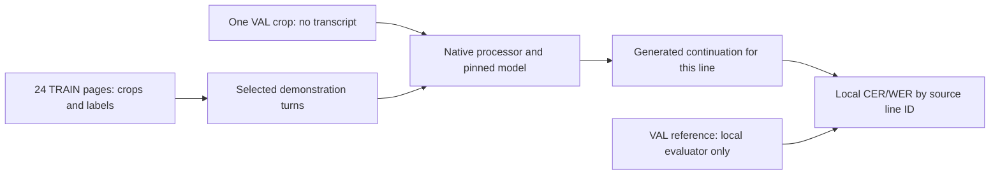

# Post EXP-015–017 research analysis

**Reviewed 5 October 2026 — Manager + Research.** Completed evidence review; the proposed next study awaits user approval. No production code, experiment predictions, datasets or model weights changed, and no cloud job was launched for this review.

## 1. Conclusions and current research stage

**The executed ICL data flow is sound within the checks below.** We found no evidence of validation-label leakage, wrong image/transcript pairing in the paired arm, lost query images, context overflow, incorrect model loading or decoding the prompt as the answer. This does not certify that every inference interface is appropriate for every model.

Two measurement issues matter: the historical page evaluator suppresses insertion errors by replacing length-flagged outputs with empty strings, and the inherited `truncated` flag can include outputs that finish with EOS at exactly 64 tokens. EXP-016/017's primary line metrics already retain these predictions. Those corrected results support the present conclusions; the historical page scores should remain secondary.

**Qwen obtains modest gains from context, with no established advantage for including demonstration images. The saved 24-page LoRA checkpoint is substantially stronger. LightOnOCR's transferred Qwen protocol fails, but its best native handwriting performance was not established.** The latter is a limitation of the comparison, not an explanation that has been experimentally isolated.

Our research has progressed from building and verifying an OCR active-learning pipeline to investigating **how a limited labelled bank should be used: through weight adaptation, inference context, or both**. EXP-011–013 did not establish consistent superiority of the tested acquisition strategies. EXP-015–017 now justify a bounded follow-up: **does context add useful information after adapting Qwen to the same bank?**

## 2. What actually ran

The shared task is **recognition at known text-line locations**. READ2016 supplies the regions and transcripts; the model predicts text, not boxes. Source transcripts simulate annotation. We have not measured real annotator effort.

| Component | Verified setting |
| --- | --- |
| Source | READ2016 v1.2.0: 350 TRAIN pages / 8,367 lines; 50 VAL pages / 1,043 lines. Frozen collection: 400 pages / 9,410 lines. |
| Label bank | Exact EXP-013 random-selection seed-824 first batch: 24 TRAIN pages / 589 lines. |
| Development slice | VAL8: Seite0355–0362, 182 lines. |
| Reported full slice | VAL42: Seite0363–0404, 861 lines. This is already examined official validation data. |
| Input | Original-pixel bounding rectangle of each supplied line polygon; eight-pixel padding, clipping to the page, RGB conversion, longest edge at most 1,024 pixels, then the model's native processor. No polygon masking or deskewing. |
| Instruction | `Transcribe only the text in this cropped line. Return only the transcription.` |
| Qwen | `Qwen/Qwen3-VL-4B-Instruct`, revision `ebb281ec70b05090aa6165b016eac8ec08e71b17`. |
| LightOn | `lightonai/LightOnOCR-2-1B-base`, revision `c1bc8eb6625be7b34178ff53481b242f7b8ffcb8`. This is the original EXP-009 base, before RLVR. |
| Decoding | BF16, evaluation mode, greedy generation, at most 64 new tokens, repetition penalty 1.1, Hugging Face Transformers on L4. |
| Context selection | Deterministic per-query random sampling without replacement from the sorted bank IDs; seed, bank hash and query identity bind the draw. Eight examples are a prefix of the 24. |

For **each query line**, a fresh independent conversation contains demonstration user turns with crop + instruction and assistant turns with the corresponding TRAIN transcript. The final user turn contains only the query crop + instruction. The processor adds the generation prompt; the model generates; the runner slices off the input tokens before decoding the continuation. Stored line text trims boundary whitespace and replaces generated newlines with spaces. Evaluation then applies the frozen NFC text view. “Raw line” below means these stored predictions are retained even when long or malformed; it does not mean unprocessed token bytes.



**Paired** keeps correct associations. **Text-only** removes demonstration images while retaining their transcripts, turns and the query image. **Mismatched** rotates demonstration images by one while retaining transcript order and the query. The two models receive identical bank IDs and context draws. No query transcript is sent to the inference worker or used to select examples.

Qwen's zero-shot receipt comes from EXP-012; paired outputs from EXP-015 and controls from EXP-016. They are explicitly reused and rechecked. LightOn's line-level zero-shot was executed anew in EXP-017: EXP-009's whole-page baseline is incompatible. EXP-015–017 performed no fitting. The EXP-013 LoRA24 reference used all 589 bank lines for one epoch; an ICL query sees only 8 or 24 lines. Equal available labels do not imply equal exposure or input tokens.

## 3. Implementation audit and remaining qualifications

Manager inspected the executed paths in [icl.py](../src/active_ocr/icl.py), [region_pipeline.py](../src/active_ocr/region_pipeline.py), [recognition_pipeline.py](../src/active_ocr/recognition_pipeline.py), [icl_controls.py](../src/active_ocr/icl_controls.py), [evaluation.py](../src/active_ocr/evaluation.py) and the [PAGE converter](../src/active_ocr/integrations/public_dataset.py). Existing execution audits were checked against current files, rather than inferred from task history.

| Check | Finding |
| --- | --- |
| Original annotation conversion | A direct XML check independent of the production parser verified all 400 pages / 9,410 lines: complete IDs, literal transcripts, polygon-derived rectangles and declared reading order match the manifest. |
| Experiment inputs | Original XML and image identities/dimensions were checked for all 74 involved pages: 24 bank + all 50 validation pages. Bank labels match TRAIN; validation payloads contain geometry/IDs without `target`. Three blank validation references remain included. |
| Evidence and code identity | Rehashed 124 files bound by the EXP-016/017 audits; five executed module hashes still match EXP-017's frozen recipe. All seven pinned LightOn model files match their recorded hashes. |
| Conversation assembly | Image order, assistant labels, query placement and continuation slicing agree with the intended protocol. All 28,416 full mismatched associations have different region IDs and different transcripts, not accidental equal-label matches. |
| Images and capacity | Saved processor checks confirm expected 1/9/25 images. LightOn's largest full prompt is 5,271 tokens; adding 64 is below 16,384. No input image was silently dropped. |
| Generation and scoring | Existing independent audits cover all 7,357 main EXP-017 outputs / 54 chunks, output-token decoding, context identities, coverage and edit counts. Eight native-format diagnostic predictions are recorded separately. Metrics are locally recomputed, not accepted solely from cloud summaries. |
| Tokenizer/model concerns | Saved tokenizer checks, model-file hashes and weight-loading evidence do not support a tokenizer corruption or missing-weight explanation. Template support for multiple images establishes serialization, not learned few-shot ability. |
| Visual inspection | The existing diagnostic crop contact sheet was inspected. It contains the expected historical handwriting and page-number crops. Rectangular envelopes can include surrounding ink; no polygon-mask equivalence to another benchmark is claimed. |

The new read-only audit is saved as `.local/verification/exp-017/post-exp015-017-review.{py,json}`. Its receipt records `passed: true`, inspection HEAD `e6a6d63812cb2dc5bd27287996d0995c5471cdaf`, the source checks and the experiment-audit hashes. It extends the previous audits without replacing original evidence. Reproduce locally with:

```sh
PYTHONPATH=src .venv/bin/python .local/verification/exp-017/post-exp015-017-review.py
```

### Issues that should affect our interpretation

1. **Historical scoring can reverse the conclusion.** LightOn paired-24 appears to improve page CER from 0.899142 to 0.838187 under the cap-as-empty convention. Retaining predictions at fixed line boundaries instead gives 1.523463 → 3.597373. The older convention removes many insertion errors and permits alignment across neighbouring lines. Preserve it for provenance, not as the research headline.
2. **A length flag is not always a length stop.** Eight LightOn full outputs ended in EOS at exactly 64 tokens but inherited `truncated=True`. Actual length stops by condition are 35 / 314 / 556 / 408 / 106 / 256 / 512 in table order below. Future bookkeeping should distinguish EOS from forced stopping; the primary metric already keeps all eight.
3. **The LightOn interface was not calibrated for its training regime.** Its authors describe inference without task prompts and explicitly identify unconstrained handwriting as outside the released checkpoints' target use case. [LightOnOCR paper, §§2.1 and 6](https://arxiv.org/html/2601.14251v1). Its [authored base-model card](https://huggingface.co/lightonai/LightOnOCR-2-1B-base) demonstrates a single image-only turn and distinguishes the fine-tuning base from the best OCR variant. The fixed instruction/multi-turn protocol is a valid transfer test; it is insufficient for a best-model claim. The eight-line image-only diagnostic improved CER 6.068182 → 3.833333 on those eight lines, but remains too small for a native baseline.
4. **Repetition penalty interacts with context.** The executed Transformers processor penalizes previously seen token IDs including the prompt. Adding transcripts therefore changes penalties on potentially correct output tokens. This behaviour is documented in [RepetitionPenaltyLogitsProcessor](https://huggingface.co/docs/transformers/internal/generation_utils#transformers.RepetitionPenaltyLogitsProcessor). It is an unseparated decoder/context interaction, not proof that it caused the observed gains or failures. EXP-015 already tested penalty 1.0 on VAL8: mean raw line CER worsened 0.834989 → 0.985223 and length flags rose 2 → 25. Simply repeating or adopting 1.0 is unjustified.
5. **Pixels, effective resolution and protocols are different concepts.** LightOn and Qwen encode identical crops differently. LightOn zero-shot crops span 8–490 visual tokens. No coordinate-scaling error was found, but thin-stroke preservation, padding, rectangular envelopes and native patch merging have not been isolated experimentally. Future input changes need a small controlled comparison and fresh matching baselines.
6. **Scientific scope remains limited.** One bank and one context draw per query do not estimate context variability. Historical LoRA construction was not seeded before adapter initialization, so results describe that saved checkpoint, not an average adaptation effect. Writer/document grouping and pretraining overlap are unknown. VAL8 and VAL42 are not fresh final tests. There is no box-detection, annotation-time-saving or generalization claim.

## 4. Verified findings

All primary metrics below cover the same **861 lines, 16,899 reference characters and 2,675 reference words**. CER/WER are corpus edit-count ratios, retaining output from every line, including three blank references. Rates above 1 are possible because of insertions. “64 tokens” counts exact-length outputs, including the EOS cases discussed above.

| Condition | Qwen CER | Qwen WER | Qwen 64 tokens | LightOn CER | LightOn WER | LightOn 64 tokens |
| --- | ---: | ---: | ---: | ---: | ---: | ---: |
| Zero-shot | 0.863601 | 1.174579 | 2 | 1.523463 | 2.005981 | 35 |
| Paired 8 | 0.798331 | 1.121121 | 2 | 3.323747 | 3.761121 | 316 |
| Paired 24 | 0.808924 | 1.122243 | 3 | 3.597373 | 3.808972 | 556 |
| Text-only 8 | 0.805965 | 1.130093 | 1 | 6.349962 | 6.937196 | 411 |
| Text-only 24 | 0.798095 | 1.098692 | 0 | 4.224155 | 4.708411 | 106 |
| Mismatched 8 | 0.968874 | 1.293084 | 2 | 2.964377 | 3.414206 | 259 |
| Mismatched 24 | 0.948695 | 1.263551 | 5 | 3.472750 | 3.681869 | 512 |
| Saved Qwen LoRA24, no context | **0.430499** | **0.834766** | 0 | — | — | — |

### Qwen: a context benefit, with unresolved image contribution

Paired-8 lowers CER by **6.53 percentage points** from zero-shot. Correct pairing improves line edit counts for 422 queries, ties 152 and worsens 287. LoRA24 improves 774, ties 57 and worsens 30 against zero-shot. This supports a substantial adaptation benefit for that checkpoint.

The paired advantage over text-only at eight shots is only **0.76 CER points**. At 24 shots, text-only is **1.08 points better**. Paired-8 and text-only-24 differ by four character edits. Without repeated draws or uncertainty estimates, these are small observed differences, not equivalence or a stable winner. More shots are not consistently better.

Mismatches hurt, but this can reflect contradictory examples rather than transferable glyph learning. Unexpected Cyrillic falls from 164 zero-shot queries to 2/0 for paired 8/24, 4/1 for text-only and 1/0 for mismatched. Thus context influences language/output behaviour even with wrong associations. Linguistic/task priming is plausible, but its causal contribution has not been isolated. No separate faithfulness project is proposed here.

### LightOn: output failure dominates the controls

Paired-8 worsens 674/861 line edit counts; paired-24 worsens 745/861. Zero-shot has 145 empty outputs, all on nonempty references. Context removes empties but produces more wrong text. Text-only repeats the complete instruction on **535/861** eight-shot and **674/861** 24-shot queries.

Mismatches score slightly better than paired context while remaining far worse than zero-shot. Changes in repetition and stopping dominate this result; it does not establish successful ICL or prove images are unused. The findings concern the pinned pre-RL base with the transferred protocol. No matched LightOn line-trained LoRA control exists. EXP-009's successful fine-tuned whole-page results use a different task, exposure and recipe.

## 5. Comparison with the closest HTR ICL paper

**P1 — Ayllon, Gandia and Calvo-Zaragoza, [Exploring In-Context Learning for Handwritten Text Recognition](https://arxiv.org/html/2609.37195v1)**, arXiv v1, 29 September 2026; preprint. Read §§3–6 and Appendix A; Tables 1–3, 5–6.

| Design | P1 | Our study |
| --- | --- | --- |
| Qwen | 8B Instruct | 4B Instruct |
| Queries | Test split | VAL42 |
| Support | TRAIN | Fixed TRAIN24 bank |
| Context draws/query | 30 | 1 |
| Shots | 0–16 | 0/8/24 |
| Collection size | 9,504 samples | 9,410 frozen lines |

| Qwen CER (%) | Zero | 8 shots | 16 shots |
| --- | ---: | ---: | ---: |
| P1 average | 80.95 | 81.96 | 78.78 |
| P1 oracle minimum | 80.95 | 57.12 | 55.61 |
| Local ordinary draw | 86.36 | 79.83 | Not run; 24-shot is 80.89 |

P1's minimum uses each reference answer to select the best context; it is not a deployable selector. Its average also shows difficult READ recognition and limited improvement. Our pattern is compatible, not an exact replication or leaderboard comparison. Exact prompt/decoding/preprocessing and split/export equivalence remain unverified; no resolving study repository was located.

## 6. Related research: what is established and what remains open

**Search/access date: 5 October 2026.** Research used the installed Systematic Literature Review and Scientific Brainstorming skills. Manager independently checked the central comparison, official model interfaces, decoder behaviour and key prior-art claims. This is a **focused primary-source review**, not an exhaustive systematic review or proof of absence of earlier work.

Searches covered HTR ICL, modality controls, writer adaptation, trained/contextual hybrids, retrieval and historical OCR correction. Representative queries: `historical handwritten text recognition multimodal in context learning fine tuning retrieval`, `"handwritten" "LoRA" "in-context learning" hybrid`, `"OCR" "fine-tuning" "in-context learning" "text-only"`, and central-paper title/code searches. Sources: arXiv, CVF, ACL Anthology, Springer and official Hugging Face documentation. Included papers directly informing comparisons, mechanisms or novelty; excluded product claims, unverified summaries and unrelated retrieval tasks. Where an arXiv version was read, later publication equivalence is not assumed. No pooled meta-analysis is appropriate for these different tasks and metrics.

| Primary paper; verified version/status and read scope | Relevant evidence and transfer limit |
| --- | --- |
| **P2 — Shuo Chen et al., [Can Multimodal Large Language Models Truly Perform Multimodal In-Context Learning?](https://arxiv.org/html/2311.18021v2)**. v2, 7 Dec 2024; [WACV 2025](https://openaccess.thecvf.com/content/WACV2025/html/Chen_Can_Multimodal_Large_Language_Models_Truly_Perform_Multimodal_In-Context_Learning_WACV_2025_paper.html). §§3–5. | Image-removal/text-corruption controls and MMICES show that selecting visually related examples can provide useful text even when demonstration images add little. VQA/captioning with older models; its architecture-specific explanation does not diagnose Qwen3. Retrieval and modality ablations are established. |
| **P3 — Folco Bertini Baldassini et al., [What Makes Multimodal In-Context Learning Work?](https://arxiv.org/html/2404.15736v2)**. v2, 25 Apr 2024; [CVPR Workshops 2024](https://openaccess.thecvf.com/content/CVPR2024W/PV/html/Baldassini_What_Makes_Multimodal_In-Context_Learning_Work_CVPRW_2024_paper.html). §§3–5, figures/tables. | Task-dependent image contributions, answer similarity and recency/copying effects under retrieval. Classification majority voting cannot be assumed to explain free-form HTR. Retrieved-context improvements need controls beyond comparison with random. |
| **P4 — Said Taghadouini, Adrien Cavaillès and Baptiste Aubertin, [LightOnOCR: A 1B End-to-End Multilingual Vision-Language Model for State-of-the-Art OCR](https://arxiv.org/html/2601.14251v1)**. v1, 20 Jan 2026; technical preprint. §§2, 4–6 and inference details. | Native interface and handwriting limitations are discussed above. OCR training includes existing crops, so using crops is not inherently unsupported. Its document benchmark does not validate multi-turn READ ICL. |
| **P5 — Tom Simon et al., [Few-shot Writer Adaptation via Multimodal In-Context Learning](https://arxiv.org/html/2603.29450v1)**. v1, 31 Mar 2026; [ICDAR 2026 publication](https://link.springer.com/chapter/10.1007/978-3-032-36033-5_36). Preprint §§3–4/Table 2; publisher metadata. | A purpose-trained 8M recognizer uses same-writer, same-split support and fuses with standard OCR. At nine examples, IAM CER is 3.92% versus 4.22% without fusion; RIMES 2.34% versus 2.91%. Trained recognition + context already exists. TRAIN-only random support for off-the-shelf Qwen is a different question. Published full-text equivalence to v1 was not verified. |
| **P6 — Shuo Chen et al., [True Multimodal In-Context Learning Needs Attention to the Visual Context](https://arxiv.org/html/2507.15807v2)**. v2, 6 Aug 2025; [COLM 2025](https://openreview.net/pdf?id=n4JdyBGu6T). §§3–4/Tables 1–2. | DARA trains attention allocation; TrueMICL requires novel visual mappings. Dedicated training to improve visual-context use is established. It neither identifies our failure mechanism nor requires us to implement an attention modification. |
| **P7 — Hongrui Jia et al., [SymDPO: Boosting In-Context Learning of Large Multimodal Models with Symbol Demonstration Direct Preference Optimization](https://arxiv.org/html/2411.11909v1)**. v1, 17 Nov 2024; CVPR 2025 proceedings listing. §§1–3; methods inspected, no numerical claim used. | Symbol-based preference training encourages models to use demonstration images. Improving ICL through training is already studied. The task and objective differ from ordinary line-transcription LoRA; a generic “fine-tuning + ICL” novelty claim would be incorrect. |
| **P8 — Farazi et al., [When Do VLMs Help Arabic Manuscript OCR? A Cross-Dataset Study](https://arxiv.org/html/2608.22366v1)**. v1, 23 Aug 2026; under-review preprint. Design and §§5.1–5.3. | Source images plus noisy OCR can help, but script-mismatched priors can hurt. Its input ablations and failure analysis support conditional correction, not a guaranteed READ remedy. Different scripts/tasks prevent direct numeric comparison. |
| **P9 — Gutteridge et al., [Judge a Book by Its Cover: Investigating Multi-Modal LLMs for Multi-Page Handwritten Document Transcription](https://arxiv.org/html/2502.20295v3)**. v3, 7 Aug 2026; venue not verified. §§3–5.1/Table 2. | Whole-document noisy OCR plus a selected page image supplies context; this is correction, not verified crop/transcript demonstrations. Document grouping and an OCR prior would be prerequisites for adopting it here. |
| **P10 — Bhandari and Harit, [Evaluating In-Context Learning and Retrieval Strategies for Devanagari Post-OCR Correction](https://arxiv.org/pdf/2609.21595)**. v1, 18 Sep 2026; preprint. PDF §§3–5/Tables 3–4. | Character n-gram BM25 over corrupted OCR is established. Synthetic Hindi/Marathi sentences and sentence-macro CER/WER differ from our corpus-weighted image recognition. Retrieval and metric gains must be checked rather than transferred. |
| **P11 — Denise Atzori et al., [Building Character(s): Synthetic Data and In-Context Learning Strategies for Few-Shot Ancient Chinese Recognition](https://aclanthology.org/2026.lt4hala-1.35/)**. LT4HALA 2026 proceedings, May; PDF §3.5/§4.1/Table 2. | Historical-character ICL and variant-aware selection already exist. Best-per-model conditions and normalization differ from average random draws. The inspected target-variant selector does not resolve how query variants are obtained without reference access; deployability remains an open detail, not an allegation of leakage. |

Official [Qwen usage](https://huggingface.co/Qwen/Qwen3-VL-4B-Instruct) supports native template construction and slicing generated continuations as used here. General generation defaults are not OCR-specific experimental evidence. Live model cards were inspected; their prose was not verified against a historical copy at the pinned weight revision.

### Plausible explanations and tests that could reject them

| Hypothesis, not an established mechanism | Evidence supporting consideration | Discriminating result |
| --- | --- | --- |
| Much of Qwen's gain is language/task conditioning. | Text-only is close to paired; even mismatches suppress wrong-script output. | A repeatable paired advantage over identical transcripts would show additional net value from demonstration images. |
| Domain adaptation makes examples more useful. | Adaptation improves recognition substantially; no adapted ICL was tested. | Adapted paired context fails to beat adapted zero/context-only text: context is redundant or harmful for that checkpoint. |
| Random draws explain small condition differences. | Only one context per query; paired/text scores are close. | Matched repeated draws reverse or erase the apparent ranking. |
| LightOn's interface contributes to output collapse. | Instruction echoes, prompt-free training, tiny native diagnostic improvement. | Adequately sized native image-only recognition is equally poor; domain/model suitability then remains a stronger explanation. |
| Prompt-token penalties contribute to context effects. | The decoder's penalty scope includes transcripts. | A small prompt-excluded penalty control leaves rankings unchanged. This would not justify rerunning all conditions. |
| Crop encoding limits recognition. | Model-native visual loads differ; rectangular crops contain surrounding ink. | A declared small resolution/masking control leaves errors unchanged. This is a diagnostic, not the default next project. |

These explanations can coexist. Mismatch harm alone does not establish visual learning. Removing images also changes sequence length/load; paired-versus-text measures the **net value of including images**, not a pure internal causal mechanism.

## 7. Recommended next research goal and novelty boundary

> **At a fixed bank of 24 labelled TRAIN pages, does eight-shot ICL improve the existing domain-adapted Qwen checkpoint beyond adaptation alone, and do correctly paired images improve it beyond the same transcripts without demonstration images?**

This connects our strongest result—adaptation—to the unresolved value of context. It can discover complementarity, redundancy or interference. It reuses existing data and weights, requires no new bank seed or fit, and supports a meaningful negative outcome.

The potential contribution is a **controlled fixed-label-bank study of the marginal value of context after ordinary VLM OCR adaptation on difficult historical handwriting**. Training-plus-context, retrieval, modality ablations and writer adaptation are prior art. We did not find this exact matched-bank interaction study in the focused search; that is a **tentative gap**, not a first-ever claim or a novel algorithm. A stronger eventual research claim needs a frozen independent evaluation and, if generalized across models/training, additional evidence.

| Alternative | Scientific value / feasibility | Decision now |
| --- | --- | --- |
| Existing LoRA + controlled ICL | Directly addresses current findings; smallest change; useful whether positive or negative. | **Recommended.** |
| Query-dependent retrieval | Could improve ordinary average performance; generic retrieval is already established. | Defer until context shows additional value; any selector must use query pixels/predictions, never query ground truth. |
| LightOn native-format recovery | Clarifies a compatibility/domain limitation; mostly engineering calibration. | Separate diagnostic only if approved; weak main novelty. |
| OCR-assisted correction | Established and potentially useful with a stronger adapted OCR prior. | Later; introduces a second inference stage and propagated errors. |
| Same-writer/document support | Relevant to stronger writer-adaptation findings. | Requires verified grouping; filenames/adjacent pages are insufficient. |
| Context-aware training / DARA / DPO | Could address visual-context limitations; substantial prior art and implementation. | Premature before the simple hybrid test. |

## 8. Staged proposal — not executed or approved

### A. Freeze prerequisites and verify the small extension

Retain seed 824, the same bank, crop settings, Qwen revision, prompt, greedy 64-token decoding and penalty 1.1. Use **eight shots only** initially; adding 24 already failed to consistently improve results. A zero-shot adapted condition means **zero context**, not zero training labels.

The current ICL worker loads the base model and records `adapter_sha256: null`. The existing region pipeline loads PEFT adapters, but adapted multi-image ICL has not been verified. After approval, add only adapter loading and its identity to the existing ICL recipe/cache/receipt; reuse the loader and evaluator. No new pipeline or dependency is needed. Preserve original runs. Correct future stop bookkeeping without discarding old predictions.

Focused local checks should cover adapter/cache separation, identical contexts across controls, no query target in payloads and stop accounting. Then a small L4 check—e.g. four representative queries × four adapted conditions—must confirm adapter loading, capacity, generated continuation and receipts. Failure pauses execution before the full pilot. This is preparation within the next approved study, not a new smoke experiment record.

### B. Screen the existing VAL8 slice

Evaluate the adapted checkpoint on all 182 lines with **no context / paired-8 / text-only-8 / mismatched-8**: at most 728 pilot predictions, with exact matching reuse where available. Use the saved draw so base-model outputs can be reused if the full input/decoder/evaluator identities match; otherwise obtain matching outputs explicitly.

Proposed practical gate to freeze before execution: at least one correct-context condition reduces CER by **2 absolute percentage points** versus adapted no-context, WER deteriorates by no more than **1 point**, and genuine length stops remain at most **1%**. These are proposed decision thresholds, not literature constants or significance tests. Inspect errors and stop for new interface failures. If neither paired nor text-only improves adapted recognition, stop expansion and report redundancy/interference. If only text-only improves, pursue that cheaper-input explanation without a visual-learning claim. Paired must beat text-only before claiming additional value from images.

### C. Only after a promising screen, measure context robustness on VAL42

Keep one labelled bank and one existing adapter. Propose **three matched context draws per query**, including the saved draw; this is not three new bank seeds or three training runs. Query-to-query randomness does not estimate repeated-context variability for the same query.

For a model-state interaction comparison, run base and adapted models with paired-8 and text-only-8 under the same three draws: **10,332 eight-shot predictions before matching reuse**. Reuse existing first-draw base outputs and exact no-context receipts; do not select the best draw using labels. Mismatched-8 is already a pilot diagnostic; expand it only if an unresolved association question warrants it. Fix demonstration ordering, bank IDs and all decoding before confirmation.

Report each draw and the mean corpus CER/WER, line/page win/tie/loss summaries, genuine stop reasons, empties, echoes, output lengths and inference/token load. Use descriptive paired page-level uncertainty summaries while disclosing unknown document dependence. Three draws give a modest conditional robustness check, not a population estimate.

For model state `m`, define `G_m = CER(m, no context) − CER(m, paired)` and `V_m = CER(m, text-only) − CER(m, paired)`. Positive `G` measures practical context benefit; positive `V` measures the net benefit of including correctly paired images. Compare `G` and `V` for base and adapted checkpoints to test complementarity. This remains conditional on the saved adapter.

If the full effect disappears, record that outcome instead of increasing shots or adding retrieval automatically. If gains survive, freeze the method before a separately approved independent test. Both present validation slices have already informed decisions, so this confirmation remains exploratory. Relative efficiency should be measured; fewer fits does not automatically mean less total inference work.

## 9. Records, evidence and unchanged assets

- Reader reports: [EXP-015](../results/EXP-015.md), [EXP-016](../results/EXP-016.md), [EXP-017](../results/EXP-017.md). Technical execution records: [EXP-015](../experiments/EXP-015.md), [EXP-016](../experiments/EXP-016.md), [EXP-017](../experiments/EXP-017.md). Original approved ICL scope: [proposal](inference-adaptation-proposal.md).
- Frozen execution: EXP-017 code `2b0ccf2a6585e5536b3c6dfe3ab9d955fc92cf31`; recipe SHA-256 `d8263244146a217728e6a4ee618afc474af2bd261c30803b34a241bdf14ac4f7`. EXP-016 frozen code `18019c9`. No execution-code edits in this review.
- Provenance: source run `781d319efaa94b68bdd8027a2ae4e01c`; manifest SHA-256 `ac0a02a218a2142c6ee92ae964e7828ddfc65545dd6ca12f695815bb4493bdd6`; bank SHA-256 `b170d6bac83fd4caa5ec0fee57d358820175712e4695b5e39d55aeeb45cb0cd3`.
- **New local audit only:** `.local/verification/exp-017/post-exp015-017-review.py` and `.json`; existing diagnostic images/receipts preserved. These are ignored local evidence, not files available from a fresh Git clone.
- **Original data:** `.local/assets/read2016-1.2.0/`, `.local/prepared/read2016-v1-8db5833/`; frozen source under `.local/verification/active-learning-source/runs/`.
- **Prediction evidence:** `.local/verification/exp-015/icl-exp015-random-seed824/`, `.local/verification/exp-016/icl-exp016-controls-seed824/`, `.local/verification/exp-017/icl-exp017-lighton-seed824/`; audits, diagnostic attempts and logs remain in the respective parent directories and original Modal output Volume.
- **Base models:** `.local/assets/qwen3-vl-4b-ebb281e/` and `.local/assets/lightonocr-2-1b-base-c1bc8eb/`.
- **Saved adapter proposed for reuse:** `.local/models/exp-013/random/seed-824/round-1/adapter/`; weight SHA-256 `7e875d37b7e85032729f2b44d0d9f619f343679752812af6899596e579f4cab6`. No new adapters/models were produced.
- **Research collaboration:** existing Research task `01a0853d-58a6-7223-878f-0ac4d1c02163`, completed handoff turn `01a109e8-5b9b-7dd2-b72f-b929dd847e4e`; Manager owns this integrated note and the implementation audit. No new persistent task or schedule was created.

The next step is user review of the bounded hybrid question and gates. Development and execution have not started.
