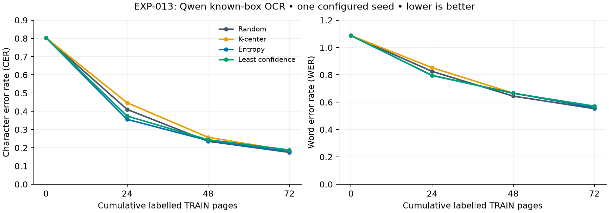

# EXP-013 — Which known-box pages should Qwen learn from?

**Completed 27 September 2026 · READ2016 · Qwen3-VL-4B-Instruct · one configured seed, 824 · Modal L4**

## Purpose and method

Does model-guided selection improve OCR when only a small number of pages can be labelled? Random, k-center, entropy and least confidence each chose their own first 24 TRAIN pages, then 24 more twice: **0 → 24 → 48 → 72 pages**. There was no shared random training checkpoint. Three fixed line crops estimated each candidate page's score; selecting a page revealed all its source transcripts to simulate human annotation. K-center used frozen visual coverage; entropy and confidence used the original model first, then their own preceding adapters.

Every fit reset from the pinned original Qwen model and trained a fresh LoRA adapter for one epoch on cumulative selected lines. All checkpoints transcribed all **861 lines of the same 42 official validation pages**, returning text in source reading order. Boxes were supplied, not predicted. The three-round stopping point was fixed before results were seen.

## Results

The **0-page result is reused, not rerun**, for every arm from EXP-012's original-model receipt: `.local/verification/region-ocr-v2/region-exp012-random-seed824/round-0.json`. Model revision, crops, prompt, decoding, validation IDs and evaluator matched; saved predictions were recomputed locally. No EXP-012 trained adapter or unequal-budget result enters this comparison.

CER is character edits per reference character; WER is word edits per reference word. Lower is better; values above 1 are possible. Every evaluation uses 17,718 reference characters and 2,675 words.

| Labelled TRAIN pages | Random CER / WER | K-center CER / WER | Entropy CER / WER | Least confidence CER / WER |
| ---: | ---: | ---: | ---: | ---: |
| 0 | 0.803646 / 1.087103 | 0.803646 / 1.087103 | 0.803646 / 1.087103 | 0.803646 / 1.087103 |
| 24 | 0.410374 / 0.825421 | 0.446947 / 0.852336 | 0.355909 / 0.795140 | 0.374026 / 0.796262 |
| 48 | 0.235749 / 0.644486 | 0.257365 / 0.666168 | 0.240038 / 0.666542 | 0.243876 / 0.665047 |
| 72 | 0.175020 / 0.552897 | 0.183768 / 0.566355 | 0.178068 / 0.559252 | 0.188114 / 0.571589 |

Differences from random below are **percentage points**, with negative values favouring the selector; these are observed differences without significance claims.

| Pages | K-center ΔCER / ΔWER | Entropy ΔCER / ΔWER | Least confidence ΔCER / ΔWER |
| ---: | ---: | ---: | ---: |
| 24 | +3.66 / +2.69 | -5.45 / -3.03 | -3.63 / -2.92 |
| 48 | +2.16 / +2.17 | +0.43 / +2.21 | +0.81 / +2.06 |
| 72 | +0.87 / +1.35 | +0.30 / +0.64 | +1.31 / +1.87 |

## Training volume and selection overlap

All selected pages' lines trained; equal page budgets therefore contain somewhat different numbers of transcripts.

| Pages | Random training lines | K-center | Entropy | Least confidence |
| ---: | ---: | ---: | ---: | ---: |
| 24 | 589 | 501 | 580 | 584 |
| 48 | 1155 | 1071 | 1160 | 1116 |
| 72 | 1725 | 1658 | 1713 | 1659 |

The reused original-model evaluation had **2/861 capped outputs**. Every trained checkpoint had **0/861 capped outputs**; empty/capped predictions count as empty text. Acquisition had 6 capped outputs among 4,818 generated sampled crops; this diagnostic did not change ranking rules.

Each overlap is the intersection of the cumulative acquired sets. Selections were never forced apart.

| Pair | Shared pages at 24 | At 48 | At 72 |
| --- | ---: | ---: | ---: |
| Random / K-center | 2 | 6 | 13 |
| Random / Entropy | 2 | 6 | 14 |
| Random / Least confidence | 2 | 5 | 17 |
| K-center / Entropy | 1 | 5 | 16 |
| K-center / Least confidence | 1 | 9 | 20 |
| Entropy / Least confidence | 16 | 24 | 37 |

## Interpretation and limits

Entropy and least confidence improved on random at 24 pages, but random led both metrics at 48 and 72 pages. At 72 pages entropy was close to random, with CER higher by 0.30 percentage points; k-center and least confidence were higher by 0.87 and 1.31 points. All arms learned substantially from additional labelled pages, but no selector maintained an advantage at all budgets. These are this pilot's observations, not proof of repeatable annotation savings. Similar uncertainty selections show that different scoring rules can still acquire many of the same pages.

This is one configured selection/Trainer seed on official validation, with unknown document grouping and possible pretraining overlap. The inherited recipe did not explicitly seed LoRA initialization before adapter construction, so small differences can also reflect training variation. No independent final TEST, box detection or human-time saving was measured. The next stronger comparison needs controlled adapter initialization and repeated seeds.

## Cost, recovery and locations

Provider app-specific gross compute snapshot: **US$9.26**, before credits, at `2026-09-27T09:30:38.695621+00:00`. It includes this experiment's interrupted attempts and recovery; it excludes the prior baseline and persistent Volume storage, and may lag final billing. No dollar threshold or workspace-limit change was imposed.

A local first-query metadata error was corrected and already valid scores/first fits reused with provenance. Modal later cancelled least-confidence 48-page validation after training; its surviving adapter was verified and evaluated without retraining. Failed attempts remain preserved.

- Reader report and curve: `results/EXP-013.md`, `results/EXP-013-learning-curves.png` (Git tracked).
- [Technical record](../experiments/EXP-013.md): recipe/code identities, exact selections, hashes, app IDs and reproduction.
- Raw receipts/predictions/caches/logs: ignored `.local/verification/exp-013/region-exp013-v2-<strategy>-seed824/` and that parent directory.
- **All 12 trained adapters:** ignored `.local/models/exp-013/<strategy>/seed-824/round-{1,2,3}/adapter/`; remote originals remain on Volume `vo-J6KGzVVUq9jFE6mJFHO1PJ` at paths in the technical record.
- Original data: `.local/assets/read2016-1.2.0/`; prepared data: `.local/prepared/read2016-v1-8db5833/`; frozen source: `.local/verification/active-learning-source/runs/`; original model: `.local/assets/qwen3-vl-4b-ebb281e/`. These assets are unchanged and ignored by Git.

The known-box pipeline and four-arm pilot are complete. EXP-012's 64-page workflow and whole-page pipeline remain preserved.
