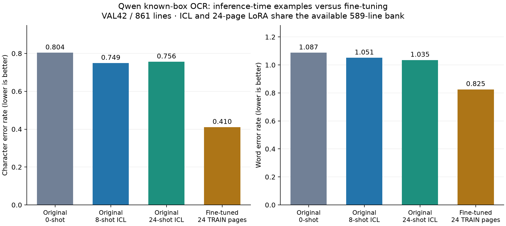

# EXP-015 — Can random in-context examples approach fine-tuned historical OCR?

**Completed 4 October 2026 · Qwen3-VL-4B-Instruct · READ2016 known-box line recognition · bank/context seed 824 · Modal L4**

## Purpose and method

Earlier experiments showed substantial improvement after learning from historical transcripts, while tested active-learning selectors did not consistently beat random acquisition. This study tests an alternative: **show labelled crop/transcript examples during inference, without changing model weights**, and compare with the saved random fine-tuning baseline.

Use READ2016's supplied text-line boxes to crop images. The model transcribes one query crop; it does not detect boxes or predict coordinates. The exact EXP-013 random first-round bank supplies **24 TRAIN pages / 589 labelled lines**. Each validation query draws 24 distinct bank lines reproducibly; the eight-shot condition uses the first eight of that same draw. Different queries may reuse examples. Demonstrations contain cropped images paired with their source transcripts; the final query contains only its crop and instruction. Validation transcripts remain evaluator-only.

**TRAIN example bank → random image/text pairs → one unlabelled VAL crop → original Qwen → saved transcription → local CER/WER.** Queries are independent; neither model weights nor conversation history accumulate across them.

Both conditions predict all **861 lines of the same 42 official validation pages**, restoring original reading order. The model revision, eight-pixel crop padding, maximum edge 1024, prompt, BF16, greedy decoding, repetition penalty 1.1 and 64-token output limit match EXP-012/013. The [recipe](../experiments/recipes/read2016-known-box-icl.json) contains the exact settings. Its training fields describe the historical fit reference; **EXP-015 performs no training**.

## Full validation results

CER is character edits per reference character; WER is word edits per reference word. Lower is better; insertions can make WER exceed 1. Every row uses **17,718 reference characters / 2,675 words**.

| Condition | Label use | CER | WER | Capped / raw-empty lines |
| --- | --- | ---: | ---: | ---: |
| Original Qwen, 0-shot — reused EXP-012 | No labelled examples or fitting | 0.803646 | 1.087103 | 2 / 0 |
| Original Qwen, 8-shot — new EXP-015 | Eight examples/query from the 24-page bank | 0.749012 | 1.050841 | 2 / 0 |
| Original Qwen, 24-shot — new EXP-015 | 24 examples/query from the same bank | 0.755954 | 1.035140 | 3 / 0 |
| Random LoRA, 24 TRAIN pages — reused EXP-013 | All 589 bank lines fitted for one epoch; 0-shot inference | 0.410374 | 0.825421 | 0 / 0 |

The **zero-shot benchmark is reused, not rerun**, from EXP-012's original known-box Qwen receipt; EXP-013 previously reused that same benchmark. EXP-013's LoRA evaluations are also reused, not retrained or rerun on GPU. Source, model revision, crop processing, prompt, decoding, validation IDs and evaluator matched; all saved metrics were recomputed locally and the adapters' hashes checked. Earlier whole-page benchmarks measure a different input task and are not pooled into this comparison.

Capped raw text is preserved but scores as empty under the unchanged evaluator. No predictions were discarded. There were zero failed queries and zero raw-empty outputs; the 8/24-shot passes had two/three capped lines respectively.

### Differences from the references

Differences below are **percentage points**, with negative values favouring ICL. These are observed differences, not significance or equivalence tests.

| ICL condition | ΔCER vs zero-shot | ΔWER vs zero-shot | ΔCER vs 24-page LoRA | ΔWER vs 24-page LoRA |
| --- | ---: | ---: | ---: | ---: |
| 8-shot | -5.46 | -3.63 | +33.86 | +22.54 |
| 24-shot | -4.77 | -5.20 | +34.56 | +20.97 |

## Findings and intuition

**Random examples helped modestly.** Eight-shot reduced character edits from 14,239 to 13,271: 6.8% relative CER reduction. Twenty-four-shot reduced them to 13,394: 5.9%. Word errors also decreased, but both prompted models still made approximately one word edit per reference word.

**More examples did not improve both metrics.** Moving from eight to 24 examples added 123 character edits, worsening CER by 0.69 points, while removing 42 word edits, improving WER by 1.57 points. There is no single winner across CER and WER between these two context sizes.

**The saved fine-tuned model was substantially stronger.** With the same available 24-page bank, its CER was 0.410, compared with 0.749/0.756 for ICL. That fit reduced CER by 48.9% relative to the original model. Under this fixed setup, random inference-time demonstrations did not approach the observed benefit of task-specific weight adaptation. This does not establish that other ICL configurations cannot work.

## Comparison with EXP-013 random active learning

EXP-013 acquired random batches and reset a fresh LoRA fit from the base model each round, training one epoch on all cumulative selected lines. Its saved curve continues to improve as the labelled bank grows:

| Labelled TRAIN pages | Training lines | Reused random CER | Reused random WER |
| ---: | ---: | ---: | ---: |
| 0 | 0 | 0.803646 | 1.087103 |
| 24 | 589 | 0.410374 | 0.825421 |
| 48 | 1155 | 0.235749 | 0.644486 |
| 72 | 1725 | 0.175020 | 0.552897 |

Only the **24-page checkpoint shares EXP-015's bank**. The 48/72-page checkpoints use larger banks and are historical context, not equal-budget controls. ICL shot count is lines shown per query, not labelled pages: both ICL conditions have a 24-page available bank. ICL and fine-tuning share labels but expose the model to them differently; this is not equal annotation time or identical transcript exposure.

Both ICL passes used all **589 bank lines / 24 pages** across queries, with **6,888** demonstration appearances for eight-shot and **20,664** for 24-shot. These are repeated prompt appearances, not additional annotations or training examples fitted into model weights.

## Pipeline verification and resources

Twelve focused local cases passed, then a fresh L4 readiness check generated 24 outputs on eight separate diagnostic lines at 0/8/24 shots. Coverage, pairing, isolation, context/image counts and memory checks passed before full evaluation. Those diagnostic scores remain separate from the full results above; [EXP-014](EXP-014.md) retains the earlier development/testing evidence.

Full execution produced **1,722 predictions** in 28 resumable 64-query chunks; the two final chunks each contain 29 lines. Every condition's coverage and local metrics were checked before progressing. The final audit verified contexts, receipts/checksums, source/code identities and all historical references. Both Modal apps are confirmed stopped; no new model or adapter was trained, and no production-code change was needed for this run.

All cloud inference used L4. Largest full 24-shot input: **4,358 tokens / 25 images**, plus a 64-token output allowance; peak reserved memory **10.54 GiB**. Summed timed generation sections were **649.88 s** for eight-shot and **1,351.43 s** for 24-shot, approximately **2.08×** longer. These exclude input preparation, model loading and queue time; they are not end-to-end cost comparisons with fine-tuning.

## Where everything is stored

Paths below are relative to `/Users/bowenbryant24/Downloads/FYP`.

| Item | Location |
| --- | --- |
| Reader report and figure | `results/EXP-015.md`, [PNG](EXP-015-comparison.png), [SVG](EXP-015-comparison.svg) |
| Technical methods, hashes, app IDs, reuse provenance and reproduction | [experiments/EXP-015.md](../experiments/EXP-015.md) |
| Frozen inputs, bank, contexts, original references, predictions, chunks, calls and audits | `.local/verification/exp-015/icl-exp015-random-seed824/` |
| Local tests, cloud logs, app-state proof and audit/plot scripts | `.local/verification/exp-015/` |
| Original data / prepared data | `.local/assets/read2016-1.2.0/` / `.local/prepared/read2016-v1-8db5833/` |
| Frozen source | `.local/verification/active-learning-source/runs/` |
| Unchanged original model | `.local/assets/qwen3-vl-4b-ebb281e/` |
| Reused trained adapters | `.local/models/exp-013/random/seed-824/round-{1,2,3}/adapter/` |

Remote query receipts remain on output Volume `vo-J6KGzVVUq9jFE6mJFHO1PJ` under `/icl-exp015-random-seed824/{check,full}/shot-N/`. The EXP-013 adapter originals remain on that Volume at `/output/region-exp013-random-seed824/round-1/adapter/` and `/output/region-exp013-v2-random-seed824/round-{2,3}/adapter/`. **No `.local/models/exp-015/` directory is needed: this experiment produced predictions, not trained weights.** Reports and figures are Git-tracked; large data/models and raw runtime evidence are Git-ignored.

## Current research stage and limits

The first full random-ICL pilot is complete. The pipeline worked; the observed adaptation benefit remains much stronger for the saved fine-tuned checkpoint. Larger random contexts gave mixed marginal gains. This is one bank/context seed, one prompting/decoding recipe and an already examined official-validation slice. Writer/document grouping and pretraining overlap remain unknown; the historical LoRA fit has an initialization limitation. These results cannot establish statistical equivalence, independent generalization, repeatable annotation savings or box detection. No further experiment is launched by this report.

## Post-run audit and paper comparison — 4 October 2026

### Audit verdict and actual data flow

**EXP-015 correctly executed its declared recipe.** The review found no mismatched image/transcript pairs, validation-label leakage into prompts, missing queries, repeated cache rows, reading-order errors or incorrect reported edit counts. This establishes execution and scoring correctness; the decoding and measurement limitations below still constrain the research conclusion.

| Step | What was checked |
| --- | --- |
| Source and crops | Independently read original PAGE XML for all 66 participating pages: 589 TRAIN and 861 VAL lines. Polygon envelopes, transcripts, declared reading order, image hashes and dimensions match the frozen records. Crops use original-pixel coordinates, eight-pixel padding and a 1024-pixel maximum edge. |
| Demonstrations | All 589 bank targets match the original TRAIN transcripts. Every query's saved random draw is reproducible, contains distinct TRAIN line IDs, and has its eight-shot prefix nested within the 24-shot draw. |
| Model input | Each demonstration is a user crop/instruction followed by its assistant transcript. The final user message has an unlabelled query crop; the model generates that query's answer. Coordinates and query labels are absent from model input. |
| Trigger and output | The pinned base Qwen runs in evaluation/inference mode with BF16 and greedy `generate`, repetition penalty 1.1 and 64 new tokens. Each query constructs a fresh conversation; no optimizer, adapter or previous-query history is used. Only newly generated tokens are decoded. |
| Runtime and resume | All 1,722 full prediction rows match their chunk identities, checksums and contexts. Real local processor reconstruction of the shortest and longest saved 24-shot prompts, at both shot counts, reproduces runtime token/image counts and assistant-label order exactly. Largest input plus output allowance: 4,422 tokens against a 262,144-token limit. |
| Evaluation | An independent Wagner–Fischer edit-distance implementation reproduced CER/WER and integer counts for zero-shot, both ICL passes and all three saved random LoRA checkpoints. Receipt provenance and adapter hashes also match. |

A local restart initially failed because Finder had added **three `.DS_Store` files** inside the frozen source tree. All **804 declared source files** remained byte-identical. The metadata was preserved outside the inventory in `.local/verification/exp-015/source-metadata/`; strict source verification then passed. No dataset image, XML, label, recipe or production code was changed. The failed check log is retained.

### Observations worth understanding

**The model's language/script choice changed much more than its transcription accuracy.** A Unicode scan of raw outputs found Cyrillic characters absent from the corresponding reference in **164/861 zero-shot outputs, 2/861 eight-shot outputs and 0/861 24-shot outputs**. For example, source `Antoni Jacob` produced `Аннари Форов` without demonstrations, `Eustachius forstv` with eight and `Gustav forov` with 24. The prompted outputs return to Latin script while still misreading the name. This supports language/script conditioning as one benefit of ICL; it does not isolate the cause or establish improved visual decoding.

**More shots help some queries and harm others.** Relative to zero-shot, eight-shot reduces line edit counts on 421 lines and increases them on 287; 24-shot improves 418 and worsens 306. Between 24 and eight shots, 317 lines improve, 216 tie and 328 worsen; page CER worsens on 28 of 42 pages. These paired observations explain why a larger context does not produce a consistently better score. One 24-shot answer exactly matches one of its demonstration transcripts; an isolated match is insufficient evidence of a systematic copying bug.

**Capped outputs include genuine generation pathologies.** Saved examples contain repeated numbers or fragments such as `G. G. G.` and `Hr. Hr. Hr.`. Execution succeeded, but the text is unsuitable. The existing cap flag means output length reached 64 tokens; saved receipts do not retain terminal token IDs, so they cannot distinguish an unfinished sequence from EOS arriving exactly at the limit. Zero execution failures should not be interpreted as zero recognition failures.

Scoring capped raw text instead of replacing it with empty text gives diagnostic CER **0.810757 / 0.755559 / 0.766057** for zero/eight/24 shots. The ordering stays the same, and both ICL conditions remain substantially worse than LoRA24. Thus the cap policy does not explain the central finding. These are offline sensitivity calculations, not replacement experiment results.

**Page CER differs from line-corpus CER.** The permanent evaluator joins lines with newlines before page-level alignment: 17,718 characters include 819 inserted separators. Independently aligning each line uses 16,899 reference characters and prevents cross-line alignments. Its diagnostic CER is **0.856560 / 0.791408 / 0.798272**, versus **0.430499** for LoRA24. The original transcripts, including three empty lines, remain unchanged. This measurement choice preserves our internal comparison but matters when reading line-recognition papers.

### A decoding confound to test

**Repetition penalty 1.1 also penalizes tokens present in the demonstrations.** The installed Transformers 5.6.0 implementation and a small CPU logits probe confirm this: an already-present token's positive logit of 1 becomes approximately 0.909, while an unseen token stays at 1. The prompt is included because no prompt-exclusion setting is supplied. This agrees with the [versioned Transformers implementation](https://github.com/huggingface/transformers/blob/v5.6.0/src/transformers/generation/logits_process.py).

Consequently, demonstrations can provide useful spelling examples while decoding discourages reuse of their token IDs. More examples broaden the penalized vocabulary; the penalty is applied once per distinct token, not repeatedly for each appearance. In the two reconstructed queries, reference-token coverage in the prompt increases from 3/8 to 5/8 and from 4/11 to 7/11 between shot counts. **The mechanism is verified; its contribution to EXP-015's errors is unmeasured.** The fixed setting was faithfully carried over from EXP-012/013, so this is an experimental confound rather than an implementation mismatch.

### Comparison with the cited paper

Verified: Eric Ayllon, Abel Gandia and Jorge Calvo-Zaragoza, [*Exploring In-Context Learning for Handwritten Text Recognition*, arXiv:2609.37195v1](https://arxiv.org/html/2609.37195v1), 29 September 2026. Its image/transcript demonstrations are randomly resampled per query, compatible with our basic construction. It uses Qwen3-VL-8B, original test splits, 30 contexts/query, 0–16 shots and vLLM; ours uses 4B, VAL42, one draw/query and Transformers.

| CER (%) | 0 shots | 8 shots | 16 shots | 24 shots |
| --- | ---: | ---: | ---: | ---: |
| Paper: Qwen3-8B, ICFHR16 in-domain mean | 80.95 | 81.96 | 78.78 | — |
| EXP-015: Qwen3-4B, permanent page evaluator | 80.36 | 74.90 | — | 75.60 |
| EXP-015: diagnostic line-corpus evaluator | 85.66 | 79.14 | — | 79.83 |

Paper numbers are from **Appendix A, Table 5**. READ2016 is difficult there too: eight-shot worsens its Qwen mean; 16-shot helps modestly. Its eight-shot oracle-minimum CER is 57.12%, selecting contexts with reference errors; this is not an available selection algorithm. The paper suggests historical-language mismatch (§5.3). Exact prompts, cropping, decoding and normalization are insufficiently specified for matched replication. These are contextual comparisons, not a leaderboard or proof that our 4B model beats 8B. [Primary paper, methods and appendix](https://arxiv.org/html/2609.37195v1).

### Interpretation and recommended next step

The evidence supports **modest improvement from random ICL, substantial residual recognition errors, and a much stronger realized fine-tuned checkpoint on the same available bank**. The paper-specific comparison does not create an expectation that random ICL must approach our LoRA result. Our larger context's mixed outcome is compatible with query-dependent demonstration usefulness, while one draw per query cannot measure that query's context sensitivity.

Two competing explanations remain: examples mainly adjust language/style while the base model struggles with historical glyphs; or part of the benefit is suppressed by prompt-inclusive repetition penalties. Model capacity and crop/prompt differences are further possibilities, not established causes. Weight adaptation exposes the model to every bank target through optimization, whereas ICL sees only eight or 24 examples in each query; these are different mechanisms despite sharing labels.

**Recommended next experiment: isolate the decoding confound before expanding the method.** After approval, keep the same bank, seed, crop processing, prompt, evaluator and model, and change only repetition penalty to **1.0**. First use the existing eight diagnostic VAL8 crops at 0/8/24 shots on L4. Verify pairing, complete inputs, outputs and cap behavior before considering full VAL42 execution. A new zero-shot condition is required because decoding changed; the old benchmark remains a historical reference. Save generated token/EOS termination evidence and report line-corpus CER alongside the existing page metric. If caps rise materially or the mechanism does not improve recognition, that challenges the decoding explanation. If the check passes, full VAL42 evaluation can measure the matched zero/eight/24-shot effect under the new decoder. A fair new comparison with fine-tuning also requires evaluating the saved LoRA24 adapter with penalty 1.0; its existing 1.1 receipt remains a descriptive reference. No retraining is needed for that control. Broader changes should follow the result.

The additional offline evidence is `review-audit.json` and `review-behavior.json` in `.local/verification/exp-015/icl-exp015-random-seed824/`, with `review-audit.py`, its log, the preserved inventory-failure log and metadata-repair receipt in the parent evidence folder. **This review launched no inference or training, changed no model or saved prediction, and created no new experiment.** EXP-015 remains completed; the follow-up awaits approval.
