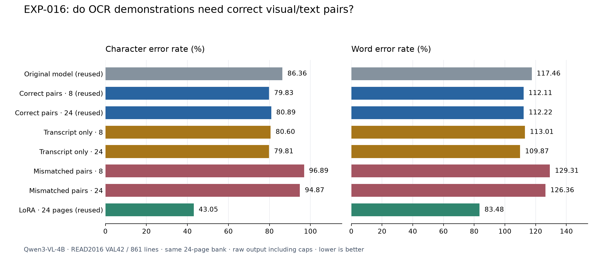

# EXP-016 — What do random OCR examples actually help with?

**Completed and independently verified 4–5 October 2026.** Transcript-only examples retained
roughly the observed benefit of correctly paired examples; mismatched pairs made OCR worse.
The saved 24-page LoRA checkpoint remained substantially stronger. These are one-bank pilot
findings, not statistical equivalence or generalization claims.

## Why this experiment

[EXP-015](EXP-015.md) showed modest random-ICL gains and a large reduction in unexpected script
outputs. Its decoder follow-up retained penalty 1.1. Before adding retrieval or larger models,
we ask: **does the benefit require correctly associated example images, or can textual domain
context account for much of it?**

## Matched setup and data flow

Use original **Qwen3-VL-4B-Instruct**, READ2016 supplied text-line boxes, the exact seed-824
**24-TRAIN-page / 589-line bank** from EXP-013 and the same **VAL42 / 861 lines** as EXP-015.
Eight/24 shots mean **line examples per query**, not training pages. Only those sampled labels
enter that query's prompt; the whole bank is available to the sampler.

For every query, draw the same distinct TRAIN line IDs in all conditions. Eight-shot uses the
24-draw's first eight IDs. Keep transcript order fixed:

- **Correct pairs:** each example crop followed by its original transcript; saved reference.
- **Transcripts only:** remove example images, retaining the same instruction/answer turns.
- **Mismatched pairs:** rotate the sampled crops left by one, independently at each shot count,
  retaining transcript order and the exact image/transcript multisets.

**The real unlabelled query crop always stays present.** Source boxes are used outside the model
to crop images; coordinates are not predicted. Each fresh conversation ends with that query;
Qwen generates its text. Validation truth stays in the local evaluator. No weights are updated.
Crops, padding, image size, prompt, BF16, greedy decoding, 64-token cap and penalty 1.1 stay fixed.

## Full results and metric meanings

Primary CER/WER align each predicted line with its fixed source ID and sum edit counts over
**16,899 reference characters / 2,675 words**. NFC normalization is applied to a copy; all saved
text, including capped repetitions and extra commentary, is scored. “Raw” means **before cap
masking**: the unchanged decoder already trims outer whitespace and replaces newlines with
spaces. CER/WER can exceed 1 because insertions count as errors.

| Condition | Raw line CER | Raw line WER | Caps | Unexpected Cyrillic lines |
| --- | ---: | ---: | ---: | ---: |
| Original, 0 shots — reused EXP-012 | 0.863601 | 1.174579 | 2 | 164 |
| Correct pairs, 8 shots — reused EXP-015 | 0.798331 | 1.121121 | 2 | 2 |
| Correct pairs, 24 shots — reused EXP-015 | 0.808924 | 1.122243 | 3 | 0 |
| Transcripts only, 8 shots — new | 0.805965 | 1.130093 | 1 | 4 |
| Transcripts only, 24 shots — new | 0.798095 | 1.098692 | 0 | 1 |
| Mismatched pairs, 8 shots — new | 0.968874 | 1.293084 | 2 | 1 |
| Mismatched pairs, 24 shots — new | 0.948695 | 1.263551 | 5 | 0 |
| LoRA, 24 TRAIN pages — reused EXP-013 | 0.430499 | 0.834766 | 0 | 0 |

Caps mean 64 generated tokens. All **eight newly capped full outputs** ended at the length limit
without EOS. Original/paired caps retain their historical flags; their terminal IDs were not saved.
All new full outputs were nonempty; there were no missing/duplicate queries or execution failures.

The historical metric joins source lines before page alignment and blanks capped lines. It uses
17,718 characters, including 819 separators. Thus its headline scores differ from the primary
line scores above. **The original benchmark was reused, not rerun or changed.**

| Condition | Historical page CER | Historical page WER |
| --- | ---: | ---: |
| Original, 0 shots — reused EXP-012 | 0.803646 | 1.087103 |
| Correct pairs, 8 shots — reused EXP-015 | 0.749012 | 1.050841 |
| Correct pairs, 24 shots — reused EXP-015 | 0.755954 | 1.035140 |
| Transcripts only, 8 shots — new | 0.752681 | 1.042991 |
| Transcripts only, 24 shots — new | 0.748279 | 1.018318 |
| Mismatched pairs, 8 shots — new | 0.877243 | 1.188037 |
| Mismatched pairs, 24 shots — new | 0.839147 | 1.117383 |
| LoRA, 24 TRAIN pages — reused EXP-013 | 0.410374 | 0.825421 |

## What the findings mean

1. **Correct example images added little average benefit over the same transcripts in this pilot.**
   Removing them worsened CER by 0.76 percentage points at eight shots, but improved it by 1.08
   at 24. Transcript-only 24 and paired eight differ by only **four character edits** across the
   whole corpus; this is too small to claim one is reliably better. Shorter text-only contexts
   are a confound, so this does not prove example images never help.
2. **Incorrect associations actively hurt.** Mismatched CER worsened by 17.05/13.98 points against
   paired eight/24, and both conditions were worse than zero-shot under both metric definitions.
   Relative to paired predictions, 435/489 lines worsened and 154/171 improved. No shuffled image
   retained its original line ID, and **zero** image/transcript pairs accidentally shared the same
   target string. This is the intended negative control, not a crop/label pipeline error.
3. **Language/script conditioning is useful but insufficient.** Transcripts alone reduced
   unexpected Cyrillic from 164 to 4/1 lines. Mismatched examples also suppressed Cyrillic while
   making OCR worse. Producing the expected script does not imply correctly reading the crop.
   This supports a textual conditioning contribution; it does not establish how new glyph
   mappings are learned or explain all gains.
4. **Fine-tuning remains the stronger realized reference.** LoRA24 raw CER is 0.430499, versus
   about 0.798 for the closest ICL conditions: a 36.76-point gap. Both methods have the same
   available labels, but fine-tuning optimizes on all 589 crops while each ICL query sees eight/24.
   This is neither equal transcript exposure nor equal human effort or compute. Weight adaptation
   may affect both language and visual decoding; this study does not separate those effects.

Prior content studies found [weak example-image effects for Flamingo/IDEFICS VL tasks](https://arxiv.org/html/2311.18021v2),
while [image-to-text generation was more sensitive to mismatched visual/text context](https://arxiv.org/html/2404.15736v2).
These motivate our controls. They use different architectures/tasks; this Qwen historical-OCR
study is not a matched replication or confirmation of their proposed internal mechanisms.

## Testing before the full run

Seventeen focused local cases and real processor image-tensor checks passed. A fresh L4 check
produced 56 outputs and exactly replayed the old paired 0/8/24 diagnostic outputs. Next, both
controls completed **all 182 VAL8 lines**; independent edit counts passed before VAL42 started.
Pilot performance did not select or remove any full condition.

| Condition | Raw line CER | Raw line WER | Caps |
| --- | ---: | ---: | ---: |
| Original, 0 shots — reused EXP-012 | 0.910573 | 1.219870 | 1 |
| Correct pairs, 8 shots — reused EXP-015 | 0.803567 | 1.175896 | 0 |
| Correct pairs, 24 shots — reused EXP-015 | 0.790828 | 1.131922 | 1 |
| Transcripts only, 8 shots — new | 0.784968 | 1.144951 | 0 |
| Transcripts only, 24 shots — new | 0.785732 | 1.099349 | 0 |
| Mismatched pairs, 8 shots — new | 0.980892 | 1.376221 | 2 |
| Mismatched pairs, 24 shots — new | 0.994140 | 1.403909 | 2 |

The full run produced 3,444 new predictions; total new output count including checks/pilot was
**4,228**, in 37 serial L4 calls. Final independent character/word counts, context/checksum audits
and all token-to-text reconstructions passed. One initial local token audit omitted inherited
newline-to-space handling; its failure log is preserved, the checker was corrected, and no
prediction, metric or cloud run was changed. All three apps are stopped with zero tasks.

## Storage, research stage and next step

Paths are relative to `/Users/bowenbryant24/Downloads/FYP`:

| Item | Location |
| --- | --- |
| Reader report / shareable chart | `results/EXP-016.md`, [PNG](EXP-016-comparison.png), [SVG](EXP-016-comparison.svg) |
| Protocol, exact identities, receipts and reproduction | [experiments/EXP-016.md](../experiments/EXP-016.md) |
| Frozen recipe, bank, contexts, reused references, new outputs and independent audit | `.local/verification/exp-016/icl-exp016-controls-seed824/` |
| Logs, scripts, processor proof and stopped-app proof | `.local/verification/exp-016/` |
| Original data / prepared data | `.local/assets/read2016-1.2.0/` / `.local/prepared/read2016-v1-8db5833/` |
| Frozen source | `.local/verification/active-learning-source/runs/` |
| Unchanged base weights | `.local/assets/qwen3-vl-4b-ebb281e/` |
| Reused trained adapter | `.local/models/exp-013/random/seed-824/round-1/adapter/` |

Remote query evidence stays on output Volume `vo-J6KGzVVUq9jFE6mJFHO1PJ` under
`/icl-exp016-{paired,text-only,mismatched}-seed824/{check,pilot,full}/shot-N/`.
**No new model/adapter was trained and no `.local/models/exp-016/` directory was created.**
Reports/code/charts are Git-tracked; data, weights and raw receipts are ignored local/remote artifacts.

The content-mechanism pilot is complete. Next I recommend a small **explicit historical-language
prompt control**: can an instruction alone reproduce the script/domain gain without a labelled
example bank? Test on VAL8 before another full run, after approval. Retrieval, model scaling and
hybrids remain untested; this does not rule them out. One bank/seed, already examined official
validation, unknown grouping/pretraining overlap and the historical LoRA initialization limitation
prevent independent generalization, statistical equivalence or annotation-saving claims.
