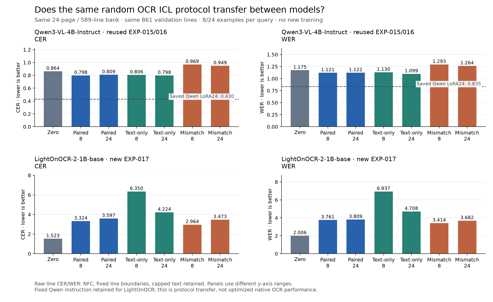

# EXP-017 — Does the same OCR ICL protocol transfer to LightOnOCR?

**Completed and independently audited, 5 October 2026.** The fixed Qwen protocol did **not**
transfer successfully: every LightOnOCR ICL condition was worse than its fresh zero-shot baseline.
This is evidence about this model and interface, not a verdict on all LightOnOCR prompting.

## Why this experiment

[EXP-015](EXP-015.md) found modest Qwen gains from random crop/transcript demonstrations.
[EXP-016](EXP-016.md) found similar gains with transcripts alone and worse results with wrong
image/transcript associations. EXP-017 repeats both studies using the original
**LightOnOCR-2-1B-base** from EXP-009, asking whether those effects transfer to an OCR-specialized
model. Qwen3-VL-4B-Instruct is the comparison; model size and training differ.

## Same data and experiment, different model

Use READ2016's supplied line boxes: crop → demonstrations plus one query → generated line text
→ local evaluation → reconstruct source reading order. This is recognition at known locations.

- Same seed 824 and exact **24 TRAIN pages / 589-line bank** from EXP-013 random selection.
- Each independent query receives 0, 8 or 24 examples. Draws are identical to Qwen; the eight are
  a prefix of the 24. All bank labels are TRAIN labels; query transcripts never reach the model.
- **Paired:** correct crop/transcript turns. **Text-only:** remove demonstration images, keep
  transcripts. **Mismatched:** rotate demonstration images by one, keep transcript order.
- Same RGB crops, eight-pixel padding, 1024 longest edge, crop instruction, greedy 64-token
  decoding and repetition penalty 1.1. Each model uses its native processor/chat template.
- Eighteen focused local checks, 56 L4 diagnostic predictions and a **VAL8 / 182-line** integrity
  pilot passed before the **VAL42 / 861-line** evaluation. All cloud work used L4.

LightOnOCR's crop-level zero-shot was **newly executed**. EXP-009's whole-page baseline cannot be
reused for a line task. Qwen's EXP-012 zero-shot, EXP-015 paired and EXP-016 control predictions
are **reused**, with provenance, identical queries/contexts and metric counts checked locally.
No fitting or new adapter was performed. This repeats the final penalty-1.1 protocol, not
EXP-015's separate penalty-selection ablation.

## Main results: all 861 validation lines

**CER** is character edits / reference characters; **WER** is word edits / reference words.
Lower is better. These primary scores use fixed line boundaries, NFC normalization and **retain
capped text**. All conditions have 16,899 reference characters and 2,675 reference words. Rates
can exceed 1 when insertions outnumber reference text; they are not bounded accuracies.

| Condition | Qwen CER | Qwen WER | LightOn CER | LightOn WER | LightOn 64-token outputs |
| --- | ---: | ---: | ---: | ---: | ---: |
| Zero-shot | 0.863601 | 1.174579 | 1.523463 | 2.005981 | 35 |
| Paired 8 | 0.798331 | 1.121121 | 3.323747 | 3.761121 | 316 |
| Paired 24 | 0.808924 | 1.122243 | 3.597373 | 3.808972 | 556 |
| Text-only 8 | 0.805965 | 1.130093 | 6.349962 | 6.937196 | 411 |
| Text-only 24 | 0.798095 | 1.098692 | 4.224155 | 4.708411 | 106 |
| Mismatched 8 | 0.968874 | 1.293084 | 2.964377 | 3.414206 | 259 |
| Mismatched 24 | 0.948695 | 1.263551 | 3.472750 | 3.681869 | 512 |

The historical **Qwen random LoRA24** checkpoint from EXP-013 is a contextual training reference:
raw line **CER 0.430499 / WER 0.834766**, zero 64-token outputs. Its saved weights were rehashed,
not retrained. LoRA fits all 589 bank lines; ICL sees only 8/24 per query, so equal bank size
does not imply equal training exposure or input tokens. There is no matched LightOnOCR
24-page line-trained control in this experiment.

## What the comparison tells us

**Qwen:** paired examples modestly improve recognition, but adding more is not consistently
better. Transcript-only results remain close to paired results; this is not statistical
proof of equivalence. Wrong associations hurt recognition. The saved 24-page LoRA checkpoint
remains substantially stronger than all inference-only conditions.

**LightOnOCR:** paired CER rises from **1.523463 → 3.323747 / 3.597373**. Relative to zero-shot,
8-shot worsens 674/861 line edit counts and 24-shot worsens 745/861. Outputs often become long
or repetitive; 24-shot reaches 64 tokens on **556/861** lines. Zero-shot has 145 empty outputs,
all on nonempty reference lines; demonstrations remove the empties but generate more wrong text.

Transcript-only is worse still: the complete instruction is echoed on **535/861** eight-shot
and **674/861** 24-shot queries. Mismatched examples are slightly better than paired in aggregate,
but remain much worse than zero-shot. Both controls change severe output failures; they do not
establish useful visual grounding or successful ICL. Every mismatched demonstration has a
wrong region ID, and **none** of those rotated pairs retains an equal transcript by chance.
No LightOnOCR condition produced unexpected Cyrillic; language-script checking alone would
therefore miss these errors.

## Why historical page scores can mislead here

The secondary metric preserves the older convention: join lines into pages and replace all
64-token outputs by empty text. It also permits edits across line boundaries. These figures
are provided for compatibility, not to override the primary result.

| Condition | Qwen page CER / WER | LightOn page CER / WER |
| --- | ---: | ---: |
| Zero-shot | 0.803646 / 1.087103 | 0.899142 / 1.326355 |
| Paired 8 | 0.749012 / 1.050841 | 1.001863 / 1.274019 |
| Paired 24 | 0.755954 / 1.035140 | 0.838187 / 1.035888 |
| Text-only 8 | 0.752681 / 1.042991 | 1.678575 / 2.105794 |
| Text-only 24 | 0.748279 / 1.018318 | 2.948753 / 3.562991 |
| Mismatched 8 | 0.877243 / 1.188037 | 1.011006 / 1.299065 |
| Mismatched 24 | 0.839147 / 1.117383 | 0.856361 / 1.070654 |

For LightOnOCR paired-24, page CER appears to improve **0.899142 → 0.838187**, while raw line CER
worsens **1.523463 → 3.597373**. Emptying 556 long outputs suppresses many insertion errors.
This ranking reversal is an evaluation-policy effect, not demonstrated OCR improvement.
Some 64-token outputs end in EOS at exactly the limit; the technical record separates those
from true length termination. None is discarded from the primary score.

## Explanation, limitations and next step

**Evidence:** source/model hashes, crop order, assistant transcripts, image counts, context
capacity, output tokens and independent edit counts passed. The largest full prompt was 5,271
tokens, plus at most 64 generated tokens, below the model's 16,384-token limit. This was not
context overflow, validation-label leakage or a missed model image.

**Inference:** interface mismatch is a plausible contributor. The
[LightOnOCR author paper](https://arxiv.org/html/2601.14251v1) describes prompt-free OCR training;
the [base-model card](https://huggingface.co/lightonai/LightOnOCR-2-1B-base) demonstrates image-only
inference and positions this base variant for fine-tuning. The retained Qwen instruction and
multi-turn examples differ from that regime. Architectural support for several images does not
establish learned few-shot competence. The extra eight-query image-only diagnostic improved
CER 6.068182 → 3.833333 on those particular diagnostic crops, but remained poor and is **not** a
full native-format baseline. Prompting, model capacity, training and crop tokenization effects
are not separated here.

[The HTR ICL study](https://arxiv.org/html/2609.37195v1) evaluates other VLMs, including a larger
Qwen, rather than this LightOnOCR base variant; its findings are not universal guarantees.
EXP-009 already showed successful **fine-tuned whole-page** LightOnOCR recognition; its different
input/task, training budget and three epochs prevent a matched comparison with this line task.

Research stage: active selection has no consistent advantage in the existing pilots; inference
context gives modest model-dependent benefits, while the saved Qwen fine-tuning reference is
stronger. The next useful test is a **small native-format LightOnOCR baseline and ICL pilot**
before another full evaluation, with its own declared protocol. It has **not** been launched.
One bank, one already examined official-validation slice, unknown document grouping/pretraining
overlap and no independent final test limit generalization. No annotation-saving or model-wide
ICL conclusion is justified.

## Records, data and model locations

- [Technical record](../experiments/EXP-017.md); [specification](../experiments/recipes/read2016-known-box-icl-lighton.json);
  comparison chart above and [editable SVG](exp-017-icl-model-comparison.svg).
- **Raw receipts, tokens, contexts and audits:** ignored
  `.local/verification/exp-017/icl-exp017-lighton-seed824/`; logs, processor/tokenizer proofs,
  diagnostic crops, native diagnostic and stopped-app evidence in its parent folder.
- **Original LightOnOCR weights:** ignored `.local/assets/lightonocr-2-1b-base-c1bc8eb/`, with
  `asset-manifest.json`; durable original model cache and predictions on the existing Modal
  output Volume. **New trained models/adapters: none.**
- **Existing dataset:** `.local/assets/read2016-1.2.0/`, `.local/prepared/read2016-v1-8db5833/`,
  frozen source `.local/verification/active-learning-source/runs/`.
- **Reused Qwen evidence:** `.local/verification/exp-015/` and `exp-016/`; original Qwen weights
  `.local/assets/qwen3-vl-4b-ebb281e/`; LoRA24 `.local/models/exp-013/random/seed-824/round-1/adapter/`.

All 54 main chunks and 7,357 main predictions were independently verified; an additional eight
native-format diagnostic outputs are stored separately. All five experiment apps are stopped.
The failed private diagnostic import is preserved; no production chunk failed. Reports,
configuration and source are Git-tracked; raw data and large model assets remain ignored.
