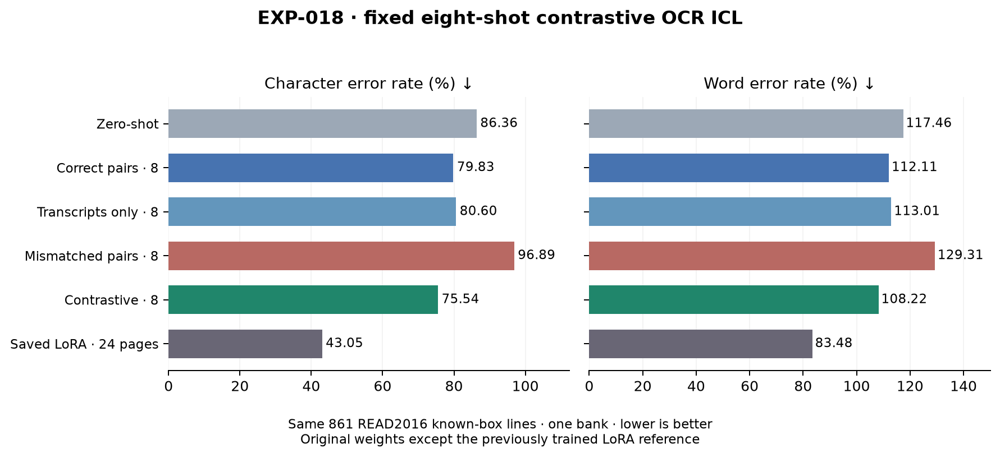
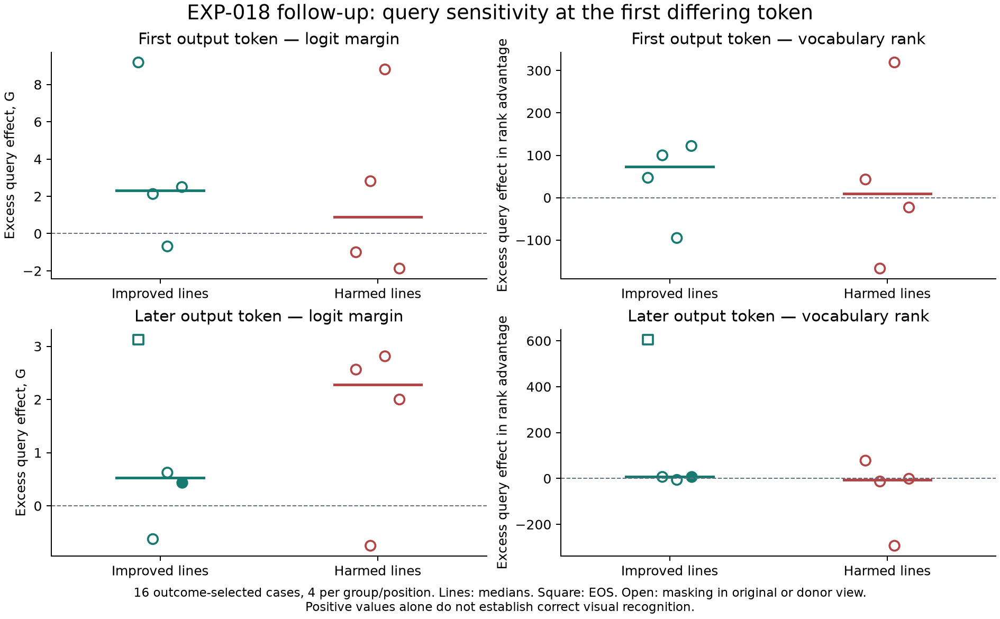
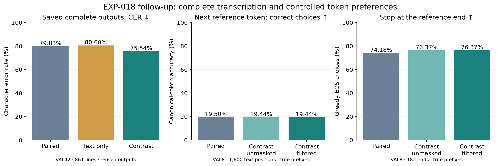

# EXP-018 — Can support contrast improve frozen-model handwriting ICL?

**Completed and independently audited, 17 October 2026.** The fixed eight-shot contrastive decoder improved raw character and word error rates on the established 42-page validation slice. The benefit carried over from the disjoint development pilot, but many lines worsened and the saved fine-tuned model remained much stronger.

## Purpose and setup

EXP-016 found that transcript-only supports performed similarly to correct image–transcript pairs, while mismatched pairs harmed recognition. EXP-018 asks whether contrasting correct and incorrect support associations can improve recognition **without changing model weights**.

Use original **Qwen3-VL-4B-Instruct**, READ2016's supplied text-line crops, the same seed-824 **24-TRAIN-page / 589-line bank**, and eight deterministic random demonstrations per query. The query always contains one real validation crop, without its transcript. Selecting supports uses TRAIN IDs only.

The positive conversation contains eight correct crop/transcript pairs. The negative conversation rotates those same eight support images left by one while retaining transcripts and their order. Both retain the same real query. At each output step, combine raw next-token scores as `zC = z+ + (z+ − z−)`, retain the declared positive plausibility set (β=0.1), apply the existing repetition penalty and greedily append **one shared token to both branches**. Their native position states and caches remain separate.

Crops thumbnailed to a longest edge of 1,024 pixels after padding of 8 pixels, then processed natively; BF16, native transcription instruction, penalty 1.1 and maximum 64 new tokens remain unchanged. Actual prompts contain **1,052–1,826 tokens per branch**, including images; both branches reserve 64 output tokens within the declared 262,144-token limit. No fitting, new labels, parameter sweep or additional model was used.

**Slice correction:** VAL8/182 (Seite0355–0362) and VAL42/861 (Seite0363–0404) have no shared pages. Earlier chat incorrectly described VAL42 as containing the pilot. This run generated all 861 contrastive predictions anew. VAL42 has been examined in earlier experiments; it is official validation, not an untouched final test.

## Matched results

All rows score the same **16,899 reference characters / 2,675 words**, aligned by source line ID. CER/WER sum per-line NFC edit counts before division. Lower is better; insertions can make WER exceed 100%. Every generated string is retained. The existing decoder trims outer whitespace and replaces newlines with spaces; the evaluator does not discard capped outputs.

| Condition | Raw CER (%) ↓ | Raw WER (%) ↓ | Character edits | At64-token limit |
|---|---:|---:|---:|---:|
| Original, zero-shot | 86.3601 | 117.4579 | 14,594 | 2 |
| Correct pairs, eight-shot | 79.8331 | 112.1121 | 13,491 | 2 |
| Transcripts only, eight-shot | 80.5965 | 113.0093 | 13,620 | 1 |
| Mismatched pairs, eight-shot | 96.8874 | 129.3084 | 16,373 | 2 |
| **Contrastive, eight-shot — new** | 75.5429 | 108.2243 | 12,766 | 0 |
| Saved LoRA, 24 TRAIN pages | 43.0499 | 83.4766 | 7,275 | 0 |

Only the contrastive row is newly executed. Zero-shot is reused from EXP-012, paired context from EXP-015, transcript-only/mismatched context from EXP-016, and the saved LoRA reference from EXP-013. Model/source/slice identities and metrics were checked; the LoRA weight hash and selected bank match. Its fitting uses all 589 bank lines, whereas each ICL query sees eight supports: equal available labels do not mean equal exposure or compute.

The old zero-shot/paired limit counts lack exact EOS metadata, so they are **limit hits**, not confirmed length stops. Exact saved tokens establish one transcript-only and two mismatched length stops. All new contrastive outputs are nonempty and end in EOS, with zero limit hits.

These are the same historical predictions, rescored consistently as raw lines. Earlier page-joined/cap-masked headline CERs—such as zero 0.803646 and LoRA 0.410374—are different metrics, not changed model results.

## How broad is the gain?

| Comparator | CER points saved | Character edits saved | Lines improved / worsened / tied |
|---|---:|---:|---|
| Correct pairs, eight-shot | 4.2902 | 725 | 324 / 182 / 355 |
| Transcripts only, eight-shot | 5.0536 | 854 | 413 / 236 / 212 |

Against each ICL comparator, 37 pages improved, four worsened and one tied; no previously correct line was damaged. Nevertheless, only 18 of 861 contrastive lines are exact matches, the same count as paired context. Partial transcription improved; absolute OCR quality remains poor.

The improvement persists outside historical token-limit cases: **605** edits saved versus paired context and **775** versus transcript-only context. Old Cyrillic-output lines account for zero and eight saved edits respectively. The result is therefore not solely a cap-handling or script-selection effect.

One optimal edit alignment gives contrastive substitution/deletion/insertion counts 9,300 / 1,537 / 1,929. Versus paired context, 678 fewer insertions account for much of the 725-edit net benefit. Versus transcript-only context, 572 fewer deletions and 339 fewer insertions offset 57 more substitutions. Contrastive output is 733 characters shorter than paired output but 233 longer than transcript-only output. This is not universal shortening; alignment-dependent counts also do not establish a human error taxonomy or a glyph-learning mechanism.

The pilot/full comparison is directionally consistent: paired/transcript-only/contrastive CERs were 80.3567/78.4968/76.6879% on VAL8 and 79.8331/80.5965/75.5429% on the disjoint VAL42. Do not interpret different absolute errors across these slices as a learning curve.

## Interpretation and next research

This is a measured improvement from inference-time reweighting under one fixed model, bank, support draw and negative permutation. It remains **32.4930 CER points behind the saved 24-page LoRA reference**. It does not establish repeatability, annotation savings, independent document/writer generalization, box detection, or that ICL now matches fine-tuning.

The method adapts [ICCD's support-association contrast](https://aclanthology.org/2025.acl-short.77/) from text classification; [VCD](https://arxiv.org/abs/2311.16922) instead perturbs query images. Direct historical-print OCR evidence in [Reading or Guessing?](https://arxiv.org/html/2605.27750v2) already shows that contrastive effects depend on language and method, and that incorrect text can remain image-dependent. None proves our gain comes from new glyph mappings.

The completed paper synthesis is in [Research's analysis](../research/exp-018-contrastive-icl-analysis.md). The bounded query-image follow-up was approved and completed on 17 October; its methods, negative screening outcome and limitations are recorded below. The conditional 64-case confirmation was not run.

## Verification and storage

18 focused checks and Ruff passed before execution; the modeling/worker functions match the verified pilot. The actual Qwen readiness gate was explicitly reused after compatibility checks. Independent saved-output auditing reproduced all six result rows and verified all 861 token decodes, shared prefixes/caches,14 chunk/call identities, image-split isolation and frozen source/control hashes. The single Modal app is stopped with zero tasks.

- [Technical record, hashes and reproduction](../experiments/EXP-018.md); [fixed recipe](../experiments/recipes/read2016-known-box-icl-contrastive.json).
- Ignored raw evidence: `.local/verification/exp-018/icl-exp018-contrastive-seed824/`, including full predictions, summaries, independent audit/scripts, call log and stopped-app receipt. Remote originals remain on the existing output Volume.
- Existing data: `.local/assets/read2016-1.2.0/`, `.local/prepared/read2016-v1-8db5833/`, frozen source `.local/verification/active-learning-source/runs/`.
- Original model: `.local/assets/qwen3-vl-4b-ebb281e/`. Reused trained adapter: `.local/models/exp-013/random/seed-824/round-1/adapter/`. **No new model, adapter or checkpoint was produced.**

## Query-image diagnostic follow-up (17 October 2026)

**Completed and independently audited; the predeclared advance screen failed.** This follow-up asks whether contrastive improvements over transcript-only ICL are associated with stronger query-dependent token preferences than harmful changes. It produces no new complete transcriptions, CER/WER benchmark or trained model; the learning-curve results above remain unchanged.

We froze 16 cases from the disjoint VAL8 pilot: eight improved and eight harmed lines, with four first-token and four later-token disagreements per group, spanning seven pages and capped at two cases per group/page. Selection followed a fixed hash order before scoring. One improved EOS case was available; no harmed EOS case had a matching-grid donor. Outcomes describe whole-line edit counts, not correctness of the first differing token.

At the first differing token, replay the exact shared generated prefix under paired, mismatched and transcript-only supports. Compare each context with the original query and one fixed real crop from another page with identical processor-grid geometry. Supports, prompt tokens and native positions remain fixed within each comparison; only query pixels change. This gives **96 prefix evaluations**. Native cache replay entails 96 prefills plus 144 forced-token forward steps. No reference transcript enters a model prompt. The same original Qwen, bank, crop processing and decoder settings are retained.

For the contrastive versus transcript-only candidate tokens, measure the change in their raw score margin after query replacement. **G** is that change under contrastive scores minus the corresponding transcript-only change. A positive G indicates excess query sensitivity in this particular comparison; it is not a percentage of visual contribution or proof of correct reading. Vocabulary-rank changes provide a second readout that avoids direct logit-scale comparison.

| Decision position | Median G: improved / harmed | Median rank effect: improved / harmed | Improved cases with positive G / rank effect |
|---|---:|---:|---|
| First output token | 2.3125 / 0.90625 | 73.5 / 10.0 | 3/4 / 3/4 |
| Later output token | 0.53125 / 2.28125 | 7.0 / −7.0 | 3/4 / 3/4 |

The first-token aggregate pattern fits the proposed explanation. Later positions reverse the improved-versus-harmed raw-margin ordering, so the required agreement across position groups is absent. Positive G occurs in six of eight improved and five of eight harmed cases; it does not reliably distinguish beneficial changes in this sample.

The plausibility filter also limits interpretation: both candidates remain admissible under **both query images in only 1/16 cases**. At least one candidate is excluded in two original-query cases and 14 donor-query cases. Most exclusions appear after replacing the query with different text; this is a limitation of the counterfactual comparison, not evidence that the original decoder failed. We therefore cannot confirm the pattern outside mask effects. The reserved EOS example actually favours continuing instead of stopping, further cautioning against a universal shortening explanation.

The model does respond to query pixels: the next-token choice changes on replacement in 16/16 paired, 13/16 mismatched, 14/16 transcript-only and 15/16 contrastive contexts. These are conditional next-token choices, not newly generated transcripts. Transcript-only supports still retain a visually influential query. Such dependence does not establish that the selected text is correct or that ICL improved visual recognition. Paired and transcript-only conversations also differ in image count and layout, preventing a pure separation of linguistic and visual components.

All 32 original contrastive/transcript-only next-token choices replay exactly; all geometry checks pass; final projection/native-logit maximum error is zero. A separate NumPy audit verifies saved logits, repetition processing, masks, ranks, margins, source-based outcome groups, exact prefixes and hashes. A local float32 log-softmax reporting discrepancy was reproduced analytically and fixed with float64 auxiliary normalization. Raw inference, choices, ranks, margins and screening rules were unchanged; no GPU rerun was needed. Initial logs and derived summaries remain preserved.

**Decision:** stop before the conditional 64-case confirmation. The proposed early-preference explanation is not established by this diagnostic; neither a purely linguistic account nor absence of later visual effects follows. The original CER benefit remains measured. A subsequent study should first resolve the counterfactual/mask limitation before expanding this probe. A text-preserving image intervention is one candidate for a separately reviewed plan; no further run is authorized or started.

[Diagnostic recipe](../experiments/recipes/read2016-known-box-query-intervention.json), [technical provenance and reproduction](../experiments/EXP-018.md#query-image-diagnostic-follow-up-17-october-2026). Ignored evidence is under `.local/verification/exp-018/query-intervention/pilot/`; all source data, original weights and earlier adapters remain in the locations listed above.

## Steps 1–2 correctness follow-up (17 October 2026)

**Completed and audited; stop here for discussion before changing the decoder.** We returned to the measured EXP-018 gain to ask (1) what changes in complete transcriptions and (2) whether the existing contrast favours correct next tokens under an identical preceding answer. The working generation pipeline, model weights, supports and decoding parameters were not changed. No new complete OCR transcriptions or adapters were produced.

### Step 1: what changed in the 861 saved transcriptions?

The original raw CER/WER and all line totals reproduce. One deterministic optimal alignment gives:

| Method | Substitutions | Deletions | Insertions | Completely correct lines |
|---|---:|---:|---:|---:|
| Paired8 | 9,402 | 1,482 | 2,607 | 18 |
| Transcript8 | 9,243 | 2,109 | 2,268 | 17 |
| Contrast8 | 9,300 | 1,537 | 1,929 | 18 |

Versus paired ICL, **678 fewer insertions** account for much of the 725-edit net gain; 102 fewer substitutions partly offset 55 more deletions. Versus transcript-only ICL, 572 fewer deletions and 339 fewer insertions offset 57 more substitutions. Alignment ties can change these operation labels: this is descriptive error accounting, not proof of a cognitive or glyph-reading mechanism.

Shorter contrastive outputs contribute most of the net savings **within each comparison**:

| Contrastive output length relative to comparator | Lines vs paired | Edits saved vs paired | Lines vs transcript-only | Edits saved vs transcript-only |
|---|---:|---:|---:|---:|
| Shorter | 322 | +796 | 307 | +877 |
| Equal | 360 | +57 | 209 | +54 |
| Longer | 179 | −128 | 345 | −77 |

These are post-hoc associations, not stopping interventions. Contrastive output remains 233 characters longer in aggregate than transcript-only output, so this is not universal shortening. Removing token-limit cases still leaves 605/775 saved edits versus paired/transcript-only. A narrow literal-repetition count finds 25/29 repeated three-word sequences versus zero under contrast, all in one line per comparator. Excluding those lines still leaves 651/775 saved edits over the remaining 860 lines. Repetition alone does not explain the result; this measure counts extra occurrences of identical case-sensitive whitespace-token trigrams and does not cover every repetitive failure.

Eight examples were chosen by a fixed hash rule, two improved/two harmed against each comparator, rendered with their actual crops, and inspected. A smaller edit distance can still be poor recognition: for reference “gnūegsame Pasßbrief”, paired “ganzöblicher Rechtswauff” has 19 edits and contrastive “gänzöglich zu Münster” has 16. Both remain incorrect. The examples are illustrations, not an outcome-selected mechanism test; complete strings, IDs and crop sheets are in the raw evidence.

### Step 2: does contrast favour the correct next token?

Use all 182 VAL8 lines with the same original Qwen, TRAIN24/589 bank, eight support pairs per query, rotated-image negative branch and real query. Padding 8, longest edge 1024, native prompt, BF16, alpha 1, beta 0.1 and repetition penalty 1.1 are unchanged. At each position both branches receive the **same correct preceding answer tokens**. Score before appending the current reference token. There are **1,600 text positions plus 182 line-ending positions**; reference continuations are 2–21 tokens including EOS, with no beyond-budget target.

This is evaluator-only teacher forcing, not a deployment prompt or a new CER benchmark. It removes accumulated answer errors, but supplies helpful reference-prefix linguistic information. Exact-token accuracy uses a canonical native tokenization and is not character accuracy. Both native EOS IDs are accepted for stopping.

| Diagnostic under correct prefixes | Paired | Contrast, no filter | Contrast, deployed filter |
|---|---:|---:|---:|
| Correct next text token | 312/1,600 (19.50%) | 311/1,600 (19.44%) | 311/1,600 (19.44%) |
| Mean text negative log probability, nats ↓ | 5.5871 | 6.0743 | Infinite: 1,034 reference tokens excluded |
| Median reference-token rank ↓ | 17.5 | 19 | Not comparable across excluded targets |
| Correct EOS choice at reference end | 135/182 (74.18%) | 139/182 (76.37%) | 139/182 (76.37%) |
| Premature EOS choices at text positions | 39 | 40 | 40 |

Contrast repairs 24 wrong text-token choices but damages 25 correct ones. Text accuracy improves on three pages, worsens on four and ties on one. Equal-line weighting gives 20.02→20.24%, whereas pooled token weighting gives 19.50→19.44%; neither supports a consistent improvement. Reference ranks improve at 462 text positions and worsen at 684 (454 ties), and mean reference loss worsens. Before repetition processing, raw contrast also lowers text top-one accuracy 350→341 of1,600. Thus the lack of a broad local correctness gain is not solely caused by the repetition processor.

At the reference end, six wrong stopping choices become correct and two correct ones become wrong: a modest net four. Premature stopping does not improve. This is not evidence that stronger EOS preference always helps.

**Filter finding:** 1,034/1,600 (64.625%) canonical reference tokens lie outside the positive branch's beta 0.1 candidate set. Excluded tokens have zero probability, so their masked loss is genuinely infinite; JSON stores null plus an explicit exclusion flag rather than clipping or dropping them. However, removing the filter changes only four text decisions, all wrong-to-different-wrong, and changes no end decisions. It recovers no additional correct text token in this diagnostic. Large exclusion therefore exposes weak positive-branch support for the reference; it does not establish that widening the filter alone fixes recognition or give a bound on achievable CER under other tokenizations.

### What this means

The freely generated OCR gain remains real. This is also visible on **the same VAL8 queries**: rechecked saved paired/contrastive pilot CER is 80.36/76.69%, not just a comparison across different slices. Those results are reused, not newly generated.

The diagnostic **does not support a general improvement in literal next-token recognition under correct prefixes**. It shows a small terminal-choice benefit alongside unchanged text top-one accuracy and worse reference likelihood/rank. Complete-output gains are associated with selective sequence-length changes, but these two steps do not prove stopping causes the CER improvement. Real generated prefixes contain errors and follow different trajectories; the clean-prefix diagnostic can miss effects there. Query visual dependence, causal separation of vision/language and cross-dataset transfer remain unestablished.

The useful next discussion is whether a targeted free-running continuation/stopping control is warranted. Simply amplifying contrast or widening beta is not justified by these results. **No decoder refinement, new generation experiment, new dataset/model or Step 3 has been started.**

### Verification and new evidence

Thirteen focused tests and affected Ruff checks passed before GPU execution. All three readiness queries passed native replay at first/middle/terminal prefixes, alpha-zero equivalence and identical-branch choice checks. All 182 lines and 1,782 target positions reconcile. An independent NumPy audit reproduces 54 readouts at nine saved prefixes; a separate dynamic-programming implementation reproduces all 2,583 saved line comparisons and their character/word totals. The single L4 app is verified stopped with zero tasks. The original production runner and earlier evidence are unchanged.

- [New evaluator](../src/active_ocr/contrastive_diagnostic.py), [fixed recipe](../experiments/recipes/read2016-known-box-contrastive-diagnostic.json), and [technical provenance/reproduction](../experiments/EXP-018.md).
- New ignored raw evidence: `.local/verification/exp-018/correctness-diagnostic/`, including `step-1.json`, `length-and-repetition.json`, two example crop sheets, `recipe.json`, `preflight.json`, `readiness.json`, `part-{0,1}.json`, three tensor files, `summary.json`, `interpretation.json`, verified reused `same-slice-free-running.json`, audit/scripts, app/call receipts and logs. Remote originals remain under `/icl-correctness-f35f2e7060f3/` on the existing output Volume.
- Figure: `results/EXP-018-correctness-diagnostic.{png,svg}`. Data remain `.local/assets/read2016-1.2.0/` and `.local/prepared/read2016-v1-8db5833/`, with the same frozen source under `.local/verification/active-learning-source/runs/`.
- Base weights remain `.local/assets/qwen3-vl-4b-ebb281e/`. **No model, adapter or checkpoint was trained or produced.**
