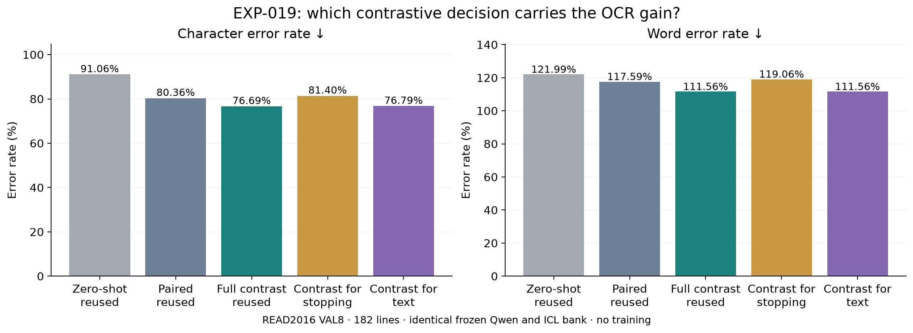

# EXP-019 — Does contrast help OCR through stopping or text choice?

**Completed and independently audited, 17 October 2026.** Applying contrast to text choices while keeping the ordinary paired stopping rule retained **140 of the full method's 144 saved character edits**. Applying contrast only to stopping did not reproduce the gain. This supports useful text decisions along generated histories in this setup; it does not establish better glyph recognition or separate visual and linguistic mechanisms.

## Question and purpose

[EXP-018](EXP-018.md) improved complete OCR transcriptions with a frozen model. Its follow-up nevertheless found no broad improvement in correct next-text-token choices when both methods received the same correct preceding answer. EXP-019 therefore asks **which conditional generation decision carries the complete-output benefit: stopping, text choice, or their interaction?** It investigates the existing decoder rather than claiming a new OCR model.

## Setup and what changed

Use the original **Qwen3-VL-4B-Instruct**, READ2016 supplied line crops, seed-824 **24-TRAIN-page / 589-line bank**, and eight deterministic supports per query, matched across arms. The sample is **VAL8: all 182 lines from Seite0355–0362**. It is previously examined official validation, not an independent final test. VAL42's 861 lines form a separate slice and are not mixed into this comparison.

The positive conversation has eight correct crop–transcript pairs. The negative conversation rotates those eight support images by one position while retaining transcript order. Both end with the same real query crop, without its transcript:

```text
user:      [support crop 1] + transcription instruction
assistant: support transcript 1
... repeat for eight supports ...
user:      [query crop] + transcription instruction
assistant: generate the query transcription, one token at a time
```

Instruction: “Transcribe only the text in this cropped line. Return only the transcription.” Supplied boxes locate runtime crops; the model predicts text, not coordinates. Padding 8 pixels, longest edge 1,024, BF16, greedy decoding, repetition penalty 1.1 and maximum 64 new tokens remain unchanged. Actual branch prompts contain **1,030–1,628 tokens**, including image tokens, within the declared 262,144-token limit with 64 output tokens reserved. No fitting, new labels, support resampling or coefficient search is involved.

At each generated prefix calculate ordinary paired scores **P** and the existing contrastive scores **C**: raw `zP + (zP − zM)`, α=1, β=0.1, with the original repetition processing and positive plausibility set. A gate stops when its best token is a native EOS token; otherwise the text rule chooses its best admissible non-EOS token.

| Condition | Stop or continue | Next text token | Evidence |
|---|---|---|---|
| Ordinary paired ICL | P | P | Verified earlier output reused |
| Full contrastive ICL | C | C | Verified earlier output reused |
| **Contrast for stopping** | **C** | **P** | **182 new predictions** |
| **Contrast for text** | **P** | **C** | **182 new predictions** |

Both new controls retain the support images: “for text” refers to the decoding rule, not transcript-only demonstrations. Each arm follows its **own generated answer**. Both branches receive its chosen answer token, with separate native caches. “Paired stopping” recomputes P on that arm's current prefix; it does not copy the old paired answer's length. No correct prefix, correct length or reference-derived stopping signal enters inference. The gate includes competition between EOS and text scores, so this is not an isolated EOS-logit intervention or a separation of model modules.

## Matched results

CER/WER sum per-line NFC edit counts and divide by the same **3,925 reference characters / 614 words**. Lower is better; insertions can make WER exceed 100%. Every string is retained. The existing decoder strips outer whitespace and replaces newlines with spaces; capped predictions are not discarded.

| Condition | CER (%) ↓ | WER (%) ↓ | Character edits | Word edits |
|---|---:|---:|---:|---:|
| Zero-shot — reused | 91.0573 | 121.9870 | 3,574 | 749 |
| Paired eight-shot — reused | 80.3567 | 117.5896 | 3,154 | 722 |
| Full contrast — reused | 76.6879 | 111.5635 | 3,010 | 685 |
| Contrast for stopping — new | 81.4013 | 119.0554 | 3,195 | 731 |
| Contrast for text — new | 76.7898 | 111.5635 | 3,014 | 685 |

Zero-shot and paired outputs are explicitly reused from EXP-015's penalty-1.1 VAL8 follow-up; full contrast is reused from the original contrastive pilot. Source/model, ordered queries, supports, frozen file/receipt identities and raw metrics were rechecked. These are not newly generated baselines. The historical zero-shot has one 64-token limit hit with incomplete EOS metadata; paired and full contrast have none. **All 364 new outputs are nonempty, end in EOS and use 2–42 tokens: zero actual length stops.**



The text control improves CER by **3.5669 percentage points** versus paired ICL; full contrast improves it by 3.6688 points. Their difference is four edits / 0.1019 points, with identical total word errors. The **97.2% retained point-estimate gain is descriptive**, not an equivalence test or an additive causal share. Stopping-only contrast worsens CER by 1.0446 points.

| Method versus paired | Edits saved (+) / added (−) | Lines improved / harmed / tied | Pages improved / harmed / tied |
|---|---:|---|---|
| Full contrast | +144 | 78 / 40 / 64 | 8 / 0 / 0 |
| Contrast for stopping | −41 | 9 / 2 / 171 | 4 / 2 / 2 |
| Contrast for text | +140 | 76 / 40 / 66 | 8 / 0 / 0 |

Text-control output is **token-for-token identical to full contrast on 172/182 lines**. All ten first divergences are verified EOS-versus-text decisions, with matching contrastive choices up to that point. Relative to full contrast, its edits improve on one line, worsen on four and tie on 177. Stopping-control strings remain identical to paired output on 166 lines. These checks support the intended intervention rather than an accidental prompt or score change.

### Where do the differences come from?

| Method | Substitutions | Deletions | Insertions | Output characters |
|---|---:|---:|---:|---:|
| Paired eight-shot | 2,153 | 257 | 744 | 4,412 |
| Full contrast | 2,173 | 273 | 564 | 4,216 |
| Contrast for stopping | 2,135 | 265 | 795 | 4,455 |
| Contrast for text | 2,175 | 272 | 567 | 4,220 |

The text control has 177 fewer insertions than paired ICL, offset by 22 more substitutions and 15 more deletions. It produces 192 fewer characters overall. Full contrast and the text control improve on every page:

| Page | Full contrast: edits saved | Stopping control | Text control |
|---|---:|---:|---:|
| Seite0355 | +10 | +1 | +9 |
| Seite0356 | +13 | +0 | +13 |
| Seite0357 | +17 | +5 | +15 |
| Seite0358 | +7 | +6 | +7 |
| Seite0359 | +11 | +2 | +11 |
| Seite0360 | +53 | +0 | +53 |
| Seite0361 | +12 | -5 | +12 |
| Seite0362 | +21 | -50 | +20 |

Edit-operation labels depend on the chosen optimal alignment; they are not a cognitive error taxonomy. A shorter answer is not automatically more faithful. In particular, changing non-EOS tokens can change all later text **and later stopping**, even when the gate rule stays paired. The findings therefore do not show that output-length effects have disappeared.

Only **two of 182 lines are exact matches** under paired, full contrast and both new controls. The text control still harms 40 lines versus paired. Its benefit is a partial edit-distance improvement while absolute OCR quality remains poor.

### The stopping-only loss is concentrated

Nine small improvements coexist with two harmful continuations. On Seite0362, line `41928541-35c1-432c-b461-7e10c293b021`, the reference is “Vnd weiln in solhen Man¬”. Paired output is “dann zumindest zu der Zeit” (20 edits). The stopping control continues with “von dem Wunder und der Heiligen Mutter Gottes im Jahr 1520.”, reaching **71 edits**. It still ends in EOS before the 64-token limit. This single case adds 51 errors; the other harmful line adds five, against 15 saved across nine improved lines.

A **post-hoc sensitivity check**, not an alternative primary result, removes that worst stopping-control line from every method: full contrast then saves 146 edits, the text control 142 and the stopping control ten. Thus one continuation drives the negative sign, but stopping alone still does not explain most of the full gain. The main tables retain that line.

Fixed-hash example selection also shows why a small improvement is not accurate reading: for “Als Ir Gnaden herrn”, paired “Alb's für Grunderzeugung” has 14 edits and the text/full output “Alts für Grunderfangung” has 13. Both remain wrong. All strings and the complete selected examples are in the raw evidence.

## What we learned and what remains open

**Supported:** the useful contrastive text-choice rule preserves nearly all of the full decoder's gain under actual generated histories, even when the explicit stop/continue rule remains paired. A stopping-only explanation is insufficient in this sample. This narrows the mechanism more meaningfully than the earlier association between shorter answers and fewer errors.

**Not established:** contrast improves general next-token recognition under correct prefixes, teaches glyph mappings, separates linguistic from visual computation, or works across datasets/models. EXP-018's clean-prefix text result (312→311 correct choices of 1,600) remains unchanged. Clean and model-generated histories ask different conditional questions; a sequence-level benefit with no broad clean-prefix benefit is not a pipeline contradiction. Error propagation or avoidance is a plausible explanation to investigate, not a demonstrated cause.

[Wang and Sennrich (ACL 2020)](https://aclanthology.org/2020.acl-main.326/) connect generated-history errors and domain-shift hallucinations in translation; their training intervention is not our frozen OCR method. [Murray and Chiang (WMT 2018)](https://aclanthology.org/W18-6322/) show that length calibration can affect translation quality. These motivate careful controls, but neither proves our OCR mechanism or its novelty.

**Recommended next discussion:** retain full contrast as the measured method and test whether the text-versus-stopping finding transfers with frozen settings to the separate VAL42 slice, using verified references. This would test slice robustness, not independent final generalization. A later mechanism test should examine whether contrastive text decisions avoid harmful continuations under generated histories; another coefficient sweep or claiming better visual reading would be premature. Nothing further has been launched.

Current stage: **completed inference-time component ablation**, following the measured EXP-018 gain and its clean-prefix diagnostic. One bank/support draw and eight examined pages remain exploratory evidence; stronger publication claims need independent transfer and a validated explanation.

## Verification and storage

Seven focused tests and affected Ruff passed before execution. Six actual native-token endpoint replays passed before the remaining production queries. The independent CPU audit reproduced **910 matched line-score comparisons**, checked all **4,173 generated token decisions/cache traces**, and reconstructed scores/masks from raw vectors at **16 positions**. Source labels/boxes, support rotation, query geometry, model/source/reference identities and receipt hashes passed. The separate trajectory check above passed. The figure was visually checked. One L4 app completed two sequential calls and is verified **stopped, zero tasks**.

- [Technical record, hashes and reproduction](../experiments/EXP-019.md); [fixed specification](../experiments/recipes/read2016-known-box-components.json); [implementation](../src/active_ocr/contrastive_components.py).
- New ignored raw evidence: `.local/verification/exp-019/components-seed824/` — both complete receipts, per-line comparisons, exact tokens/traces, frozen recipe/source, tensor samples, audit scripts/results, call log and stopped-app receipt. Remote originals: `/exp019-components-6e54c282f341/` on output Volume `vo-J6KGzVVUq9jFE6mJFHO1PJ`.
- Reused references: `.local/verification/exp-015/decoding-ablation/penalty-1.1/pilot.json` and `.local/verification/contrastive-icl-pilot-2026-10-12/pilot/results.json`.
- Existing data: `.local/assets/read2016-1.2.0/`; prepared manifest `.local/prepared/read2016-v1-8db5833/pages.jsonl`; frozen source `.local/verification/active-learning-source/runs/`. Crops are made at runtime from supplied boxes.
- Original weights: `.local/assets/qwen3-vl-4b-ebb281e/`. **No new model, adapter or checkpoint was trained or produced.** Existing pipelines, datasets, base weights and prior evidence remain unchanged. Public code/reports/figures are local changes on `research/exp-019-components`, not pushed.
