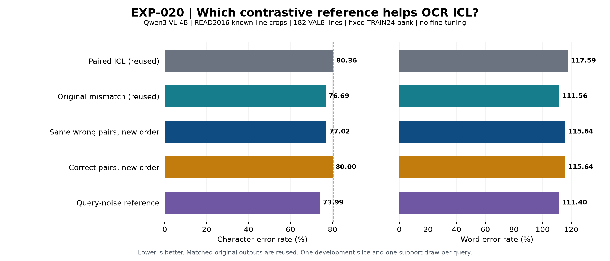
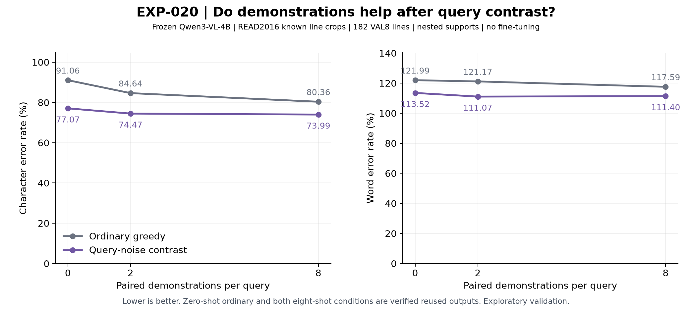

# EXP-020 — Does the contrastive reference matter for handwriting OCR?

**Complete and audited, 18 October 2026.** The four-reference comparison and approved zero-/two-shot extension are complete on **all 182 VAL8 lines**, with 1,092 new predictions across both phases. This is a one-bank official-validation pilot, not a new final-test result. Known source boxes supply the line locations; the model predicts text only. No fine-tuning or new adapter was involved.

## Purpose and setup

EXP-018 improved OCR by contrasting correctly paired demonstrations with mismatched ones. EXP-019 found that its text decisions retained the observed benefit. Here we tested whether that benefit depends on broken image–transcript associations, ordinary context ordering, or the choice to preserve rather than corrupt the query in the reference branch. EXP-019's component interpretation applies to its original reference; it is not automatically a mechanism claim about the new references.

Use frozen **Qwen3-VL-4B-Instruct**, revision `ebb281ec70b05090aa6165b016eac8ec08e71b17`, and READ2016's supplied text-line crops. The bank is the same seed824 selection of 24 TRAIN pages/589 transcripts. Each query receives eight deterministic random supports; those eight can differ between queries, but are identical across methods for the same query. Every condition evaluates the same 182 lines from Seite0355–0362. Query transcripts enter only offline evaluation.

Native conversation: eight repetitions of **user: support crop + instruction → assistant: its TRAIN transcript**, followed by **user: query crop + instruction → assistant: generated transcription**. The instruction is “Transcribe only the text in this cropped line. Return only the transcription.” Crops retain padding 8/longest edge1024; decoding retains BF16 greedy, repetition 1.1, max 64, alpha 1 and beta 0.1. Both branches receive the same generated answer prefix and keep independent native caches. Prompts contain1,030–1,628 tokens per branch, nine images and a 64-token output reservation, within the 262,144-token model limit; no input truncation.

All contrast conditions use the same positive conversation and `zP + (zP-zN)`, followed by the existing repetition/plausibility processing. The negative/reference N changes:

| Reference | What changes in N? | What stays fixed? |
|---|---|---|
| Original mismatch, reused | Rotate support images; retain transcript order | Support multiset and real query |
| Same wrong pairs, changed order | Reorder exactly those incorrect pairs using the inverse transcript rotation | Incorrect pair multiset and real query |
| Correct pairs, changed order | Rotate complete correct pairs together | Correct pair multiset and real query |
| VCD-style query noise | Add fixed step 500 diffusion noise only to normalized query pixels | Every correct support pair, token IDs and image grids |

The last is an adaptation of [VCD's official noise mechanism](https://github.com/DAMO-NLP-SG/VCD/blob/master/vcd_utils/vcd_add_noise.py) to eight-shot crop OCR. It is not an exact replication of its original model/task benchmark. The plan, strengths, noise level and evaluation were frozen before outcomes; no coefficient search followed.

## Results

CER counts character edits divided by 3,925 reference characters; WER counts word edits divided by 614 reference words. Lower is better. WER can exceed 100% because insertions count. All outputs remain in the primary metrics, including capped or unusual strings. Existing generation formatting strips outer whitespace and replaces newlines with spaces; evaluation then applies NFC without spelling correction or cap masking, retaining source line boundaries.

| Condition | Evidence | CER (%) ↓ | WER (%) ↓ | Character edits |
|---|---|---:|---:|---:|
| Zero-shot, no demonstrations | Reused | 91.0573 | 121.9870 | 3,574 |
| Paired eight-shot | Reused | 80.3567 | 117.5896 | 3,154 |
| Transcript-only eight-shot | Reused | 78.4968 | 114.4951 | 3,081 |
| Native mismatched eight-shot (no contrast) | Reused | 98.0892 | 137.6221 | 3,850 |
| Original mismatch contrast | Reused | 76.6879 | 111.5635 | 3,010 |
| Same wrong pairs, changed order | New | 77.0191 | 115.6352 | 3,023 |
| Correct pairs, changed order | New | 80.0000 | 115.6352 | 3,140 |
| Query-noise contrast (VCD-style) | New | 73.9873 | 111.4007 | 2,904 |

Zero-shot and paired outputs are reused from EXP-015's penalty1.1 VAL8 pilot; transcript-only/native mismatches from EXP-016; original contrast from the EXP-018 development pilot. Original file/receipt/model/data/context identities and raw metrics were verified. They were not relabelled as newly generated. These are **VAL8 raw corpus scores**, not the different VAL42 scores reported earlier. No unmatched LoRA score is inserted into this table.

| Contrast condition | Edits saved vs paired | Lines helped/harmed/tied | Pages helped/harmed/tied | Exact lines | Length stops |
|---|---:|---|---|---:|---:|
| Original mismatch contrast | +144 | 78/40/64 | 8/0/0 | 2 | 0 |
| Same wrong pairs, changed order | +131 | 72/40/70 | 8/0/0 | 2 | 1 |
| Correct pairs, changed order | +14 | 46/60/76 | 1/6/1 | 2 | 0 |
| Query-noise contrast (VCD-style) | +250 | 86/51/45 | 7/1/0 | 2 | 0 |

## What the result means

**1. Broken associations behave differently from an ordinary order change.** Original and reordered wrong-pair references save 144 and 131 edits and improve all eight pages. Correct-pair order contrast saves only14 edits, harms six pages, improves one and ties one. Its largest correction saves 109 edits; without that same line its remaining effect is95 additional errors. The evidence therefore does not support explaining the mismatch result simply as a generic order-contrast benefit. However, two tested orders do not establish permutation invariance: CER differs by 13 edits, WER by 25 word edits, and the reordered wrong-pair arm has one genuine length stop.

**2. Our support reference has no demonstrated performance advantage over the tested query-noise reference.** VCD-style contrast has the best primary CER:73.9873%, saving250 edits versus paired and 106 versus original contrast. It improves seven pages versus each, but still harms51 lines versus paired. Its WER advantage over original contrast is only **one word edit** (684 versus 685), so the broader word-accuracy claim should be modest. Similar scores are not equivalence and no significance or universal ranking is claimed.

**3. Excess-output reduction dominates the best arm's net gain.** Against paired ICL, query-noise contrast records242 fewer insertions, nine fewer substitutions and one more deletion. Output length falls from 4,412 to 4,169 characters. Exact lines remain **two** for paired and all four contrast methods. This is useful sequence-level error reduction, not demonstrated glyph learning, pure visual grounding or separation of vision and language modules. S/D/I are descriptive optimal-alignment counts and can have alignment ties.

**4. A large continuation case matters, but does not explain the whole benefit.** On one23-character source line, paired ICL makes130 character edits; original contrast 99, wrong-pair reorder105 (the sole new64-token length stop), correct-pair reorder21 and query noise29. The line accounts for70 of the query-noise arm's106 extra saved edits over original contrast. A secondary common181-line subset, excluding this capped line from every method, still gives CER 77.50% paired,74.60% original contrast,74.78% wrong-pair reorder,79.93% correct-pair reorder and 73.68% query noise. Thus the best arm's advantage persists but shrinks. The primary table retains all 182 lines; this sensitivity is descriptive, not a new benchmark or a reason to discard a hard line.

## Research position and next direction

**Measurement:** association-disrupting references help in both tested orders, but an established query-corruption reference performs better on the primary metric. **Inference:** reference choice matters; neither a generic order account nor a special advantage for our support reference is established. **Open question after the reference phase:** whether the query-contrast benefit also exists without demonstrations. The completed extension below tests it.

[ICCD](https://aclanthology.org/2025.acl-short.77/) already supplies a mapping-contrast principle, and [VCD](https://arxiv.org/html/2311.16922v1) supplies query corruption. The broader [novelty review](../research/exp-018-contrastive-icl-analysis.md#post-exp-019-novelty-review-and-proposed-next-study) remains applicable. EXP-020 is a controlled empirical result; picking the best existing reference here is not a new method contribution. Do not invest in further support-permutation formulas merely to obtain a better score.

The user-approved zero-/two-shot extension below now answers that missing-control question.

## Exploratory extension: zero, two and eight demonstrations

**Completed and independently audited, 18 October 2026.** This user-approved follow-up stays under EXP-020, before broader VAL42 confirmation. It asks two separate questions: **does query contrast help without demonstrations, and do demonstrations still help once query contrast is available?** Zero, two and eight refer to labelled line examples per query, not pages or training rounds.

We added 546 predictions: zero-shot query contrast, ordinary paired two-shot and paired two-shot query contrast,182 each. The two examples are the first two of each query's frozen eight-example order from the same TRAIN24/589 bank. They are identical between the two-shot conditions. Zero-shot contains no support image or transcript. Every query is a provided line crop; native messages alternate user support-crop/instruction and assistant TRAIN transcript, followed by the user query crop/instruction and generated assistant answer. The query's reference transcript is never sent to the model.

All settings stay fixed: original Qwen revision, crop processing, instruction, alpha=1/beta=0.1, noise step 500, greedy BF16, repetition 1.1, max 64 and native EOS. Query-only Gaussian realizations match the earlier eight-shot arm. Zero-shot has one image and 89–217 prompt tokens; two-shot has three images and 292–607 tokens; eight-shot has nine images and 1,030–1,628 tokens. Each reserves64 answer tokens within the 262,144 context limit; no input truncation. Ordinary generation uses the clean positive branch only. Noise metadata in its raw record supports technical checks and does not change its generation.

All scores below use the same 182 lines,3,925 reference characters and 614 words. Zero-shot ordinary and both eight-shot cells are **verified reuse**, not fresh executions. WER can exceed 100% because insertion errors are counted.

| Shots / decoding | Evidence | CER (%) ↓ | WER (%) ↓ | Character / word edits |
|---|---|---:|---:|---:|
| 0, ordinary | Reused EXP-015 | 91.0573 | 121.9870 | 3574 / 749 |
| 0, query contrast | New extension | 77.0701 | 113.5179 | 3025 / 697 |
| 2, ordinary | New extension | 84.6369 | 121.1726 | 3322 / 744 |
| 2, query contrast | New extension | 74.4713 | 111.0749 | 2923 / 682 |
| 8, ordinary | Reused EXP-015 | 80.3567 | 117.5896 | 3154 / 722 |
| 8, query contrast | Reused EXP-020 reference phase | 73.9873 | 111.4007 | 2904 / 684 |

### Findings and interpretation

**Query contrast helps even without ICL.** Zero-shot CER falls 91.0573→77.0701%:549 fewer character edits, with 99 lines helped and 53 harmed; seven pages improve and one worsens. It also beats ordinary eight-shot on primary CER (77.07 vs 80.36%). Therefore the entire contrastive gain cannot be attributed to learning from demonstrations. This is evidence for a useful established query-corruption baseline, not a novel ICL method by itself.

**Demonstrations retain an additional benefit after contrast.** Adding two paired examples reduces CER 77.0701→74.4713%, saving 102 edits; all eight pages improve in aggregate, although 78 individual lines improve and 66 worsen. Eight examples save 121 edits versus zero-shot contrast, improving seven pages and tying one. Thus dropping demonstrations entirely loses some accuracy in this pilot. These are conditional performance effects, not a causal separation of visual and linguistic modules.

**Two and eight contrastive shots are close, with different tradeoffs.** Eight-shot is 19 character edits better (0.4841 CER points), while two-shot is two word edits better. Pages split 4/4 and the line comparison is 67 helped/63 harmed/52 tied when going from two to eight. This does not establish equivalence or a universal optimal shot count. Exact lines are 5/3/2 at 0/2/8 contrastive shots, so more examples do not improve every accuracy measure.

**The error pattern suggests a useful next hypothesis.** Query contrast removes 445/410/242 insertions at 0/2/8 shots. At two shots, substitutions actually increase 25 versus ordinary decoding, despite lower total CER. In contrast, adding two examples to zero-shot contrast reduces substitutions by 149 and deletions by 9 while increasing insertions by 56:102 net saved edits, with output length increasing 4,069→4,134 characters. Its support benefit is therefore not simply shorter output. A hypothesis worth confirming is that demonstrations improve sequence content while query contrast reduces unwanted continuation. Alignment counts alone do not prove better glyph reading, visual grounding or a specific language/vision mechanism; EXP-019's original-reference stopping analysis cannot be automatically transferred here.

**A few long outputs inflate the headline differences.** One 20-character reference gives zero-shot ordinary 303 edits and contrast 17, accounting for 286 of 549 saved edits. Ordinary two-shot has two genuine 64-token length stops, both retained in primary metrics. The zero-shot legacy receipt has one at-limit flag but no saved EOS IDs, so its actual stop cannot be retrospectively asserted. On a secondary common 179-line subset removing all three at-limit cases from every condition, CER remains improved by contrast: 83.78→77.13% at zero shots, 78.11→74.32% at two, and 80.19→74.06% at eight. The ordinary two/eight ranking reverses on this subset. Consequently the primary contrast-gain pattern 13.99/10.17/6.37 points is not a robust monotonic law about shot count. All 182 outputs remain the primary benchmark; subset checks are descriptive, not replacement results.

### Research position and next step

**Measured:** query contrast provides value without examples, and a small amount of paired context adds further value here. **Hypothesis:** context and query contrast may help different error tendencies. **Unknown:** whether the pattern survives additional pages, other support choices, datasets or models. Absolute OCR quality remains poor; this is one-bank, one-draw exploratory official validation, not a publication-level generalization or annotation-efficiency result. Fixed repetition processing acts on prompt tokens too, and example identities change with shot count; these are context interventions rather than isolated module tests.

**Historical next step, now completed in [EXP-021](EXP-021.md):** a frozen 0/2/8-shot × ordinary/query-contrast comparison on VAL42, reusing exact matching ordinary baselines and testing the same error-pattern hypothesis without a prompt/coefficient sweep. VAL42's 861 lines (Seite0363–0404) have zero page overlap with VAL8, but have been used in earlier studies and are not an untouched final test. Freeze/report the comparison before running, retain all outputs and repeat the common sensitivity analysis. No VAL42 job, new formula, model fit or independent-dataset study was launched in this request; stop for review first.

## Verification and artifact locations

Eight focused checks and affected Ruff passed for the extension. Its independent audit recomputed 1,638 character/word line comparisons across nine new/reused conditions, checked 3,684 contrastive token/cache decisions, rebuilt nine native conversations and reconstructed nine first-score choices. All 546 extension outputs are nonempty; two ordinary two-shot length stops remain scored. Both extension apps are verified stopped/tasks0. The original phase evidence remains unchanged. Seven focused checks and affected Ruff passed for the reference phase. Independent CPU audit recomputed character/word metrics for 1,456 line comparisons across all eight conditions, checked 6,006 new token/cache decisions, matched all 182 positive input identities across arms, rebuilt 18 native conversations and reconstructed nine raw-score choices. All 546 new outputs are nonempty; one wrong-reorder output stops at 64 tokens and remains scored. The three experiment/audit apps are verified stopped with zero tasks. Numerical portability checks and exact hashes are in the [technical record](../experiments/EXP-020.md).

- Extension recipe: [zero-/two-shot setup](../experiments/recipes/read2016-known-box-references-shots.json); plot [PNG](EXP-020-shots.png), [SVG](EXP-020-shots.svg). Ignored extension evidence: `.local/verification/exp-020/shots-seed824/`; remote originals `/exp020-references-906e51b15b15/` on the existing output Volume.
- Code: [contrastive_references.py](../src/active_ocr/contrastive_references.py); [recipe](../experiments/recipes/read2016-known-box-references.json); [focused tests](../tests/test_contrastive_references.py). Existing generation/input/evaluation code is reused unchanged.
- Reader figure: [PNG](EXP-020-comparison.png), [SVG](EXP-020-comparison.svg). Technical provenance: [EXP-020](../experiments/EXP-020.md).
- Ignored raw evidence: `.local/verification/exp-020/references-seed824/` — recipe/bank, two prediction parts, per-arm receipts, summary, audit, interpretation, source snapshots, vectors and logs. Remote originals: `/exp020-references-fddd33bc66c1/` on output Volume `vo-J6KGzVVUq9jFE6mJFHO1PJ`.
- Existing source/prepared data: `.local/assets/read2016-1.2.0/`, `.local/prepared/read2016-v1-8db5833/`; frozen source run under `.local/verification/active-learning-source/runs/`.
- Existing original weights: `.local/assets/qwen3-vl-4b-ebb281e/`, mirrored in the pinned input bundle. **No new trained model, adapter or checkpoint exists for EXP-020.** Data and base weights are unchanged.

Current follow-up: [EXP-021](EXP-021.md) completed the approved VAL42 confirmation on 18 October. Conditional contrast/support benefits persist, but some pilot rankings do not; mechanism, novelty and independent transfer remain open. This report preserves EXP-020's original results and evidence. Its code/reports were local on `research/exp-020-references`, uncommitted/unpushed at completion; subsequent work is recorded separately.
