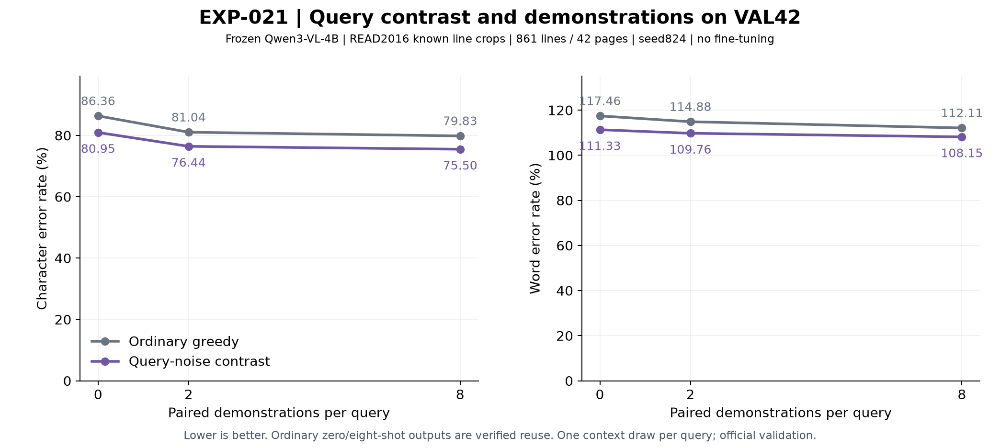
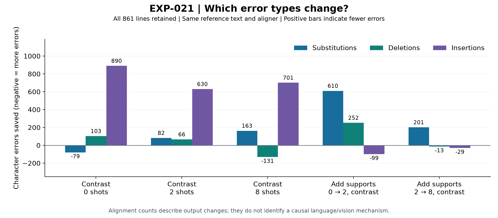

# EXP-021 — Does query contrast help OCR with few demonstrations?

18 October 2026. **Completed and independently audited.**

**Finding:** query contrast reduces error at 0/2/8 shots; two examples add a further 4.52 CER-point gain, and eight add another 0.94 points. Best CER is 75.50%, with substantial remaining errors and no established causal mechanism.

## Purpose

EXP-020 suggested two effects on a small validation slice: query-noise contrast helped even without examples, and two labelled examples provided an additional gain. This experiment freezes that setup and checks it on 861 lines from 42 different READ2016 validation pages. It asks whether these effects persist, what errors change, and whether eight examples provide more benefit than two. It is a confirmation across additional pages, not an untouched final test or a new decoding method.

## What the model receives

The original **Qwen3-VL-4B-Instruct** is frozen. We use READ2016's supplied line boxes, crop each line with eight pixels of padding, and resize its longest edge to at most 1,024 pixels. This is recognition at known locations, not box detection. The existing seed-824 bank contains **24 TRAIN pages / 589 labelled lines**. Each validation query uses its original deterministic eight-example draw; two-shot takes its first two, and zero-shot has no examples. No validation transcript enters generation.

The model's native conversation is:

```text
User:      [support crop 1] Transcribe only the text in this cropped line.
           Return only the transcription.
Assistant: [TRAIN transcript 1]
... repeat for 0, 2 or 8 support pairs ...
User:      [validation query crop] Same transcription instruction.
Assistant: [model generates the query transcription]
```

The ordinary decoder uses the clean conversation. The contrastive decoder evaluates the same answer prefix under two conversations: one with the clean query, one with Gaussian noise added to the normalized query patches. **The support pairs stay identical and correct.** It scores the next token as `zC = zP + (zP - zN)`, with alpha 1 and a positive-branch plausibility threshold beta 0.1. The actual noisy query is saved and reused exactly across shot counts. This is a VCD-style query-corruption reference, not a pure language distribution or an exact reproduction of every detail of the original VCD evaluation.

All arms retain the original model revision, native prompt, BF16 greedy decoding, repetition penalty 1.1, maximum 64 new tokens and native EOS. No fitting, prompt search or coefficient search is performed. Ordinary zero-shot outputs are verified reuse from EXP-012; ordinary eight-shot outputs are verified reuse from EXP-015. The other four conditions generate 861 new predictions each: **3,444 new outputs, 1,722 reused outputs**.

## Verified results

All six conditions use the same **861 lines, 16,899 reference characters and 2,675 words**. CER is total character substitutions, deletions and insertions divided by reference characters; WER applies the same rule to words. Lower is better. WER can exceed 100% because insertions count. These are raw NFC line-corpus scores, retaining every generated string, including length-limited output; do not mix them with older page metrics that emptied capped output.

| Shots | Decoder | Evidence | CER (%) ↓ | WER (%) ↓ | Character / word edits |
|---|---|---|---:|---:|---:|
| 0 | Ordinary | Reused EXP-012 | 86.3601 | 117.4579 | 14,594 / 3,142 |
| 0 | Query contrast | New | 80.9515 | 111.3271 | 13,680 / 2,978 |
| 2 | Ordinary | New | 81.0403 | 114.8785 | 13,695 / 3,073 |
| 2 | Query contrast | New | 76.4365 | 109.7570 | 12,917 / 2,936 |
| 8 | Ordinary | Reused EXP-015 | 79.8331 | 112.1121 | 13,491 / 2,999 |
| 8 | Query contrast | New | 75.4956 | 108.1495 | 12,758 / 2,893 |



### What this establishes

**Contrast provides a real aggregate benefit without demonstrations.** Zero-shot CER falls 86.36→80.95%, saving 914 character edits. The gain remains positive after the common long-output sensitivity checks. Therefore contrast's entire benefit cannot be attributed to learning from demonstrations. However, zero-shot contrast is worse than ordinary eight-shot here (80.95 vs 79.83% CER); its pilot advantage over ordinary eight-shot did not replicate.

**Two examples add substantial benefit beyond contrast.** Under contrast, zero→two shots saves another 763 character edits: CER 80.95→76.44%, a 4.52-point improvement. Aggregate errors fall on 37/42 pages, with 423 lines improving and 226 worsening. This replicates the pilot's conditional support benefit on additional pages. It does not establish whether the helpful information comes from support images, transcripts, their correspondence, or another context effect.

**Eight examples add a smaller, measurable benefit.** Two→eight contrastive shots saves 159 character edits and 43 word edits: CER improves 0.94 points and WER 1.61 points. Twenty-seven pages improve and 15 worsen; 322 lines improve and 271 worsen. Eight-shot has the lowest primary CER and WER of the six conditions. Two and eight are not equivalent, and this does not identify a universally optimal shot count.

| Change | Character edits saved | CER reduction (points) | Lines helped / harmed / tied | Pages helped / harmed / tied |
|---|---:|---:|---|---|
| Contrast vs ordinary, 0 shots | 914 | 5.4086 | 343 / 271 / 247 | 29 / 12 / 1 |
| Contrast vs ordinary, 2 shots | 778 | 4.6038 | 374 / 258 / 229 | 36 / 6 / 0 |
| Contrast vs ordinary, 8 shots | 733 | 4.3375 | 398 / 254 / 209 | 36 / 6 / 0 |
| Add supports, 0 → 2 with contrast | 763 | 4.5151 | 423 / 226 / 212 | 37 / 4 / 1 |
| Add supports, 2 → 8 with contrast | 159 | 0.9409 | 322 / 271 / 268 | 27 / 15 / 0 |

### What changes in the output

The following counts use one optimal character alignment. Positive means fewer errors; negative means more errors. They describe output changes rather than a causal decomposition into linguistic and visual modules.

| Change | Substitutions saved | Deletions saved | Insertions saved |
|---|---:|---:|---:|
| Contrast vs ordinary, 0 shots | -79 | 103 | 890 |
| Contrast vs ordinary, 2 shots | 82 | 66 | 630 |
| Contrast vs ordinary, 8 shots | 163 | -131 | 701 |
| Add supports, 0 → 2 with contrast | 610 | 252 | -99 |
| Add supports, 2 → 8 with contrast | 201 | -13 | -29 |



The pilot's qualitative pattern carries over: **contrast mainly reduces insertions, while demonstrations improve the sequence content under contrast.** At zero shots, 890 fewer insertions offset 79 additional substitutions. Adding two supports to zero-shot contrast removes 610 substitutions and 252 deletions, while adding 99 insertions. Output grows from 16,825 to 17,176 characters, so that support benefit is not merely shorter transcription. Going from two to eight removes another 201 substitutions but adds 13 deletions and 29 insertions.

These are useful error-pattern hypotheses, not proof of better glyph perception or a measured balance between vision and language. Exact matches remain scarce: ordinary 0/2/8-shot has 19/19/18 exact lines, versus 18/17/17 under contrast. Contrast damages 1/3/2 previously exact lines and newly corrects 0/1/1 respectively. Lower corpus error does not imply uniform improvement or more completely correct lines.

### Failures and sensitivity

All 3,444 new outputs are nonempty. Zero-shot contrast and ordinary two-shot each have **one genuine 64-token length stop**. Two- and eight-shot contrast have none. The reused ordinary zero/eight receipts each have two at-limit flags but lack output EOS IDs, so their actual stop reasons remain unknown. All these outputs remain in the primary table.

One zero-shot contrast failure is particularly clear: for `Seite0395/line_82747608-522f-49c0-b254-fdefcca56722`, reference `Waffner. hansen Wald¬`, ordinary output has 16 edits, but contrast emits a long dotted continuation with 126 edits. Adding two/eight examples reduces that to 22/17 edits, still incorrect. Conversely, on `Seite0389/line_35b48efc-8710-4b35-9d80-c6e343161bc0`, contrast reduces an unrelated 145-edit ordinary continuation to a 19-edit transcription that is shorter but still wrong. The method can suppress some continuations and introduce another; neither example proves correct reading.

Removing the **same union of six at-limit queries from every condition** leaves 855 lines / 16,752 reference characters:

| Shots | Ordinary CER (%) | Contrast CER (%) |
|---|---:|---:|
| 0 | 85.6137 | 80.2531 |
| 2 | 80.4083 | 76.3968 |
| 8 | 79.0234 | 75.4716 |

Contrast still saves 898/672/595 edits at 0/2/8 shots, and two supports still save 646 edits beyond zero-shot contrast. A separate posthoc sensitivity removing the same three largest-correction queries from all conditions retains 786/629/655 contrast gains. Thus the full-slice result is not explained solely by a few capped or exceptionally improved lines. These are descriptive checks, not replacement benchmarks or new independent tests.

### What carried over from EXP-020—and what did not

The pilot's contrastive CER improvements of 13.99/10.17/6.37 points at 0/2/8 shots become **5.41/4.60/4.34 points** on VAL42. The direction persists, but the sizes shrink. The added benefit from two supports grows from 2.60 to 4.52 points; the additional eight-shot benefit grows from 0.48 to 0.94 points, with WER now also improving. These comparisons use each slice's own denominator, not pooled percentages.

The historical EXP-018 eight-shot **mismatched-support contrast** is also a verified matching reference: 75.5429% CER / 108.2243% WER, versus 75.4956% / 108.1495% for query-noise contrast. That is only eight character edits and two word edits apart. The pilot's much larger query-noise advantage over the original mismatch reference did not carry over. This is verified reuse for context, not a newly executed seventh condition, an equivalence test, or evidence of a generally superior reference.

## Interpretation and next research question

We now have stronger evidence for **two useful conditional effects in this setup**: query contrast reduces aggregate OCR errors without examples, and a small paired context adds benefit even after contrast. The observed error patterns support a working hypothesis that query contrast restrains unwanted continuation while support context supplies useful transcription constraints. They do not identify a vision/language mechanism, and the original mismatch and noisy-query references are nearly tied on aggregate. A new decoding method or novelty claim is not established.

The next proposal was revised after user review: EXP-016 already tested paired/transcript-only/mismatched contexts; repeating these at two shots adds limited information. Instead ask whether an early contrastive token choice steers the final transcription toward fewer errors, or whether continued contrastive decisions are needed. At the first token disagreement, hold the common generated prefix fixed, force either observed candidate, and finish with the same ordinary or contrastive decoder. Two endpoints are existing outputs; two counterfactual continuations are new. The first eight EXP-021 pages contain 105 queries and 92 differing token sequences, requiring at most 184 new outputs. Score actual complete-output CER/WER and harms; do not infer correctness from image sensitivity or assume a better whole line proves its first changed token correct. This is a proposed development test only, not approved or launched. It does not by itself establish a new method or a visual/language mechanism; a publication-level contribution still needs justified improvement and independent transfer.

Absolute error is still high. This is one labelled bank and one deterministic context draw per query, on official validation pages already examined in earlier work. VAL42 is page-disjoint from the VAL8 pilot but is not an untouched final test; document/writer independence and generalization are not established. Repetition processing also sees prompt tokens, so context changes are not isolated tests of model modules. Timing here is not a fair end-to-end efficiency or billing comparison.

## Verification and completion

Ten focused tests and affected Ruff passed before cloud execution. The production readiness gate replayed original zero/eight-shot outputs, checked 12 native/alpha-zero complete sequences, rebuilt 12 conversations and independently reconstructed 12 first-score choices. The final independent CPU audit passed **all 3,444 new outputs, 5,166 condition–line character/word comparisons, 23,805 token/cache decisions, and 861 exact query-noise identities across shot counts**. Both figures were visually checked. Both EXP-021 L4 apps are stopped with zero tasks. Previous EXP-020 manifests still match all 48 and 40 entries; no earlier experiment evidence was overwritten.

Current stage: completed additional-page confirmation of contrast plus few-shot OCR; a mechanism and transferable novel method remain open. Results, code and reports are local on `research/exp-021-query-contrast`, uncommitted/unpushed. No further cloud work, fitting, tuning or final-test access is running or released.


## Records, data and models

- [Technical record](../experiments/EXP-021.md): frozen identities, readiness and full audit, source receipts, GPU calls, reproduction and limitations.
- [Experiment settings](../experiments/recipes/read2016-known-box-query-contrast-full.json); existing [runner](../src/active_ocr/contrastive_references.py).
- Raw local evidence: `.local/verification/exp-021/query-contrast-seed824/` — frozen recipe/bank/source snapshots, prediction parts and per-arm receipts, summaries, independent audit/interpretation code and output, readiness tensors, execution logs and hashes.
- Remote originals: `/exp021-query-contrast-469abd341bce/` on existing output Volume `vo-J6KGzVVUq9jFE6mJFHO1PJ`, including per-line caches, durable chunks, and every query's noisy tensor plus seeded epsilon. Only the three readiness queries' tensors are additionally mirrored locally.
- Existing source data: `.local/assets/read2016-1.2.0/`; prepared data: `.local/prepared/read2016-v1-8db5833/`; frozen source state: `.local/verification/active-learning-source/runs/` (run ID `781d319efaa94b68bdd8027a2ae4e01c` in `simulation.sqlite3`).
- Existing original weights: `.local/assets/qwen3-vl-4b-ebb281e/`, also in the pinned input Volume bundle. **No new trained model, adapter or checkpoint is produced.** Previous data, weights and adapters are preserved.
